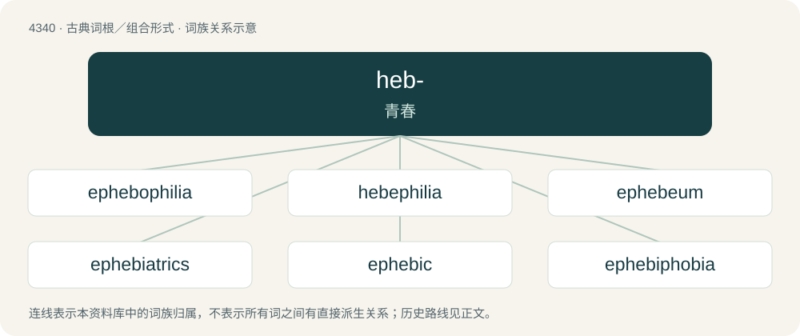

# 4340 · heb- — 青春

[总目录](../00_总目录_按常用程度.md)

**类型**：古典词根／组合形式　｜　**来源语言**：古希腊语

## 核心含义与来源

- 核心含义：青春
- 英文含义：youth
- 词形：heb-

**来源词形**：ἥβη (hḗbē), ἡβητικός (hēbētikós), ἔφηβος (éphēbos), ἡβᾶν (hēbân), ἡβάσκω, ἡβητής (hēbētḗs)

## 词族图

## 单词速览（常用到不常用）

| 单词 | 音标 | 释义 |
|---|---|---|
| [ephebophilia](#w-1) |  | 【英文】A sexual attraction towards postpubescent adolescents. |
| [hebephilia](#w-2) |  | 【英文】A sexual preference for adolescent girls. |
| [ephebeum](#w-3) | /,efəˈbiːəm/ | n. (古希腊,古罗马建筑里的)体操场 |
| [ephebiatrics](#w-4) | /iˈfiːbiə,triks/ | 青年医学, 青春期医学 |
| [ephebic](#w-5) | /iˈfiːbik/ | (有翅成虫)成虫的 |
| [ephebiphobia](#w-6) |  | 【英文】An irrational fear of adolescent people. |
| [ephebos](#w-7) | /iˈfiːbɔs/ | n. (古希腊)18至20岁刚成为公民(或刚成年)的男青年 |
| [hebephobia](#w-8) |  | 【英文】Fear, hate, or dislike of youths. |
| [hebephrenia](#w-9) | /hiːbɪˈfɹiːnɪə/ | n. \[医\]青春期痴呆 |
| [hebetic](#w-10) | /hɪˈbɛtɪk/ | a. 青春期的, 青春期发生的 |
| [hebiatrics](#w-11) |  | 青年病学; 青年医学 |

## 逐词详解

### 1. ephebophilia

**词性**：名词

**英文义项**：A sexual attraction towards postpubescent adolescents. / A sexual preference for adolescent boys.

**词源与演化**：

From Ancient Greek ἔφηβος (éphēbos, “adolescent”) + φιλία (philía, “love, friendship”). By surface analysis, ephebe + -philia.

### 2. hebephilia

**词性**：名词

**英文义项**：A sexual preference for adolescent girls. / Adult sexual attraction primarily towards pubescent children and younger adolescents, usually between 10 and 14 years old. Can fall under the same definition as pedophile.

**构词拆分**：hebe- + -philia

**词源与演化**：

From hebe- (“relating to youth”) + -philia.

### 3. ephebeum

**词性**：名词　｜　**音标**：/,efəˈbiːəm/

**中文释义**：n. (古希腊,古罗马建筑里的)体操场

**英文义项**：A hall, in an ancient Greek palaestra, used for gymnastic exercise.

### 4. ephebiatrics

**词性**：名词　｜　**音标**：/iˈfiːbiə,triks/

**中文释义**：青年医学, 青春期医学

**英文义项**：The branch of medicine that deals with the treatment of adolescents.

### 5. ephebic

**词性**：形容词　｜　**音标**：/iˈfiːbik/

**中文释义**：(有翅成虫)成虫的

**英文义项**：Pertaining to a young man or to early manhood, especially in Ancient Greek contexts.

**构词拆分**：ephebe + -ic

**词源与演化**：

From ephebe + -ic.

### 6. ephebiphobia

**词性**：名词

**英文义项**：An irrational fear of adolescent people.

**词源与演化**：

From Ancient Greek ἔφηβος (éphēbos, “youth”) + -phobia. The coinage of this term is attributed to a 1994 article by Kirk Astroth published in Phi Delta Kappan.

### 7. ephebos

**词性**：名词　｜　**音标**：/iˈfiːbɔs/

**中文释义**：n. (古希腊)18至20岁刚成为公民(或刚成年)的男青年

**英文义项**：Synonym of ephebe.

### 8. hebephobia

**词性**：名词

**英文义项**：Fear, hate, or dislike of youths.

**构词拆分**：hebe- + -phobia

**词源与演化**：

From hebe- + -phobia.

### 9. hebephrenia

**词性**：名词　｜　**音标**：/hiːbɪˈfɹiːnɪə/

**中文释义**：n. \[医\]青春期痴呆

**英文义项**：A form of schizophrenia characterized by inappropriate behavior and emotional responses. / A type of mental disorder occurring during puberty characterized by silly behavior and inappropriate laughter.

**词源与演化**：

From Ancient Greek ἥβη (hḗbē, “youthful beauty”) (also Ἥβη (Hḗbē, “the goddess Hebe”)) + φρήν (phrḗn, “mind”).

### 10. hebetic

**词性**：形容词　｜　**音标**：/hɪˈbɛtɪk/

**中文释义**：a. 青春期的, 青春期发生的

**英文义项**：Of or related to youth or to puberty.

**词源与演化**：

From Ancient Greek ἡβητικός (hēbētikós), equivalent to ἡβητ(ής) (hēbēt(ḗs)) (“adult”; ἡβη- (hēbē-), variant stem of ἡβᾶν (hēbân, “to reach puberty”), verbal derivative of ἥβη (hḗbē, “youth”) + -τής (-tḗs, agent suffix)) + ικός (ikós, “-ic”).

### 11. hebiatrics

**词性**：名词

**中文释义**：青年病学; 青年医学

**英文义项**：Synonym of ephebiatrics.

## 其他候选词

- ephebia
- hebophile
- hebophilia
