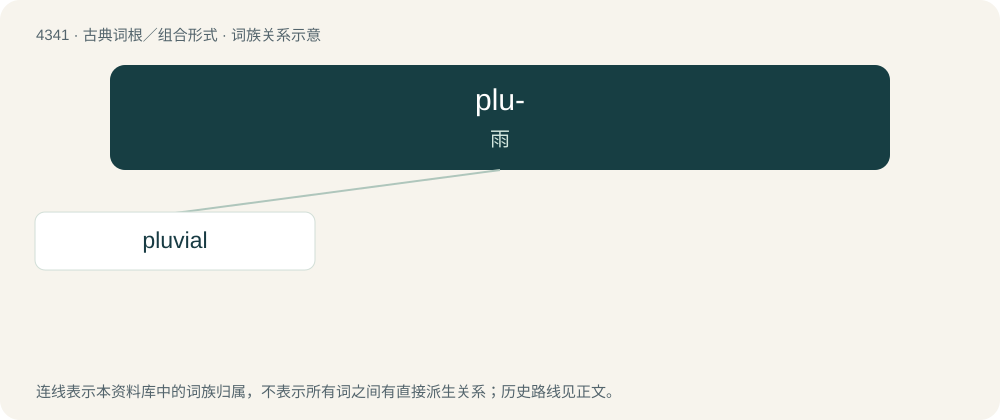

# 4341 · plu- — 雨

[总目录](../00_总目录_按常用程度.md)

**类型**：古典词根／组合形式　｜　**来源语言**：拉丁语

## 核心含义与来源

- 核心含义：雨
- 英文含义：rain
- 词形：plu-

**来源词形**：pluere, see also pluvia

## 词族图

## 单词速览（常用到不常用）

| 单词 | 音标 | 释义 |
|---|---|---|
| [pluvial](#w-1) | 英 /ˈpluː.vi.əl/；美 /ˈplu.vi.əl/ | a. 雨的, 多雨的, 洪水的；n. 雨期, 洪积世 |

## 逐词详解

### 1. pluvial

**词性**：形容词　｜　**音标**：英 /ˈpluː.vi.əl/；美 /ˈplu.vi.əl/

**中文释义**：a. 雨的, 多雨的, 洪水的；n. 雨期, 洪积世

**英文义项**：Of, pertaining to, or produced by rain. / Occurring through the action of rain.

**词源与演化**：

Borrowed from French pluvial, from Middle French pluvial, borrowed from Latin pluviālis (“pertaining to rain”).
