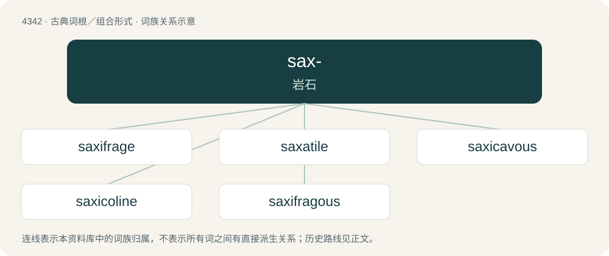

# 4342 · sax- — 岩石

[总目录](../00_总目录_按常用程度.md)

**类型**：古典词根／组合形式　｜　**来源语言**：拉丁语

## 核心含义与来源

- 核心含义：岩石
- 英文含义：rock
- 词形：sax-

**来源词形**：saxum

## 词族图

## 单词速览（常用到不常用）

| 单词 | 音标 | 释义 |
|---|---|---|
| [saxifrage](#w-1) | /ˈsæk.sɪ.frɛɪd͡ʒ/ | n. 虎耳草；\[医\] 虎耳草\[属植物\], 锐齿茴芹 |
| [saxatile](#w-2) | /ˈsæksətil/ | a. 岩生的,岩栖的 |
| [saxicavous](#w-3) | /ˈsækskeivəs/ | a. \[动\](软体动物)钻岩的 |
| [saxicoline](#w-4) | /sækˈsikəlain, -lin/ | a. 岩生的,岩栖的 |
| [saxifragous](#w-5) |  | 【英文】Dissolving bladder stones. |

## 逐词详解

### 1. saxifrage

**词性**：名词　｜　**音标**：/ˈsæk.sɪ.frɛɪd͡ʒ/

**中文释义**：n. 虎耳草；\[医\] 虎耳草\[属植物\], 锐齿茴芹

**英文义项**：Any plant in the genus Saxifraga.

**词源与演化**：

From Old French saxifrage, from Late Latin saxifraga, from Latin saxifragus (“stone-breaking”). Doublet of sassafras.

### 2. saxatile

**词性**：形容词　｜　**音标**：/ˈsæksətil/

**中文释义**：a. 岩生的,岩栖的

**英文义项**：Living among rocks.

**词源与演化**：

From Latin saxatilis, from saxum (“a rock”).

**用法示例／搭配（非完整句）**：

> a saxatile plant

该用例对应义项：Living among rocks.

### 3. saxicavous

**词性**：形容词　｜　**音标**：/ˈsækskeivəs/

**中文释义**：a. \[动\](软体动物)钻岩的

**英文义项**：Boring or hollowing out rocks.

**词源与演化**：

Latin saxum (“rock”) + cavare (“to make hollow”), from cavus (“hollow”): compare French saxicave.

### 4. saxicoline

**词性**：形容词　｜　**音标**：/sækˈsikəlain, -lin/

**中文释义**：a. 岩生的,岩栖的

**英文义项**：Synonym of saxicolous.

### 5. saxifragous

**词性**：形容词

**英文义项**：Dissolving bladder stones. / Growing in rocky crevices.

**词源与演化**：

Latin saxifragus (“stone-breaking”), from saxum (“stone”) + frangere (“to break”).
