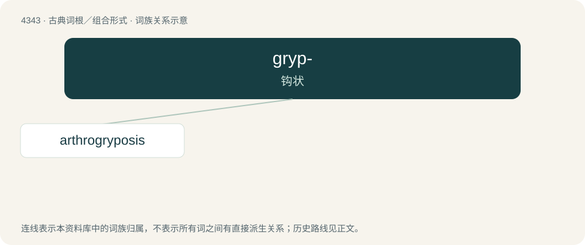

# 4343 · gryp- — 钩状

[总目录](../00_总目录_按常用程度.md)

**类型**：古典词根／组合形式　｜　**来源语言**：古希腊语

## 核心含义与来源

- 核心含义：钩状
- 英文含义：hooked
- 词形：gryp-

**来源词形**：γρυπός (grupós), γρυπότης, γρύπωσις (grupótēs, grúpōsis)

## 词族图

## 单词速览（常用到不常用）

| 单词 | 音标 | 释义 |
|---|---|---|
| [arthrogryposis](#w-1) | /,ɑːθrəj^riˈpəjsis/ | n. \[医\]关节弯曲 |

## 逐词详解

### 1. arthrogryposis

**词性**：名词　｜　**音标**：/,ɑːθrəj^riˈpəjsis/

**中文释义**：n. \[医\]关节弯曲

**英文义项**：The permanent fixation of a joint in a contracted position. / A congenital disorder in which the joints are so fixed because of lack of muscle development.

**构词拆分**：arthro- (“joint”) + gryposis (“hooking, abnormal curvature”)

**词源与演化**：

From arthro- (“joint”) + gryposis (“hooking, abnormal curvature”), from Late Latin grȳpōsis (“hooking”) (from grȳpus (“hook-nosed”)), from Ancient Greek γρυπῶσις (grupôsis, “hooking”), from γρύπεσθαι (grúpesthai, “become hooked”), from γρύπος (grúpos, “hook-nosed”).

## 其他候选词

- Grypoceras
- Gryposaurus
