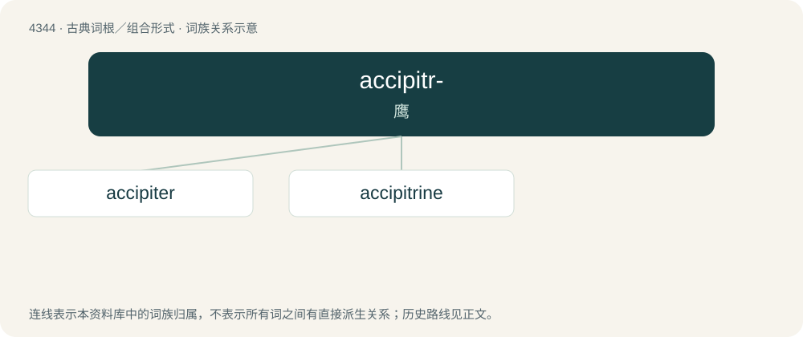

# 4344 · accipitr- — 鹰

[总目录](../00_总目录_按常用程度.md)

**类型**：古典词根／组合形式　｜　**来源语言**：拉丁语

## 核心含义与来源

- 核心含义：鹰
- 英文含义：hawk
- 词形：accipitr-

**来源词形**：accipiter

## 词族图

## 单词速览（常用到不常用）

| 单词 | 音标 | 释义 |
|---|---|---|
| [accipiter](#w-1) | 美 /ækˈsɪp.ə.tɚ/ | n. 鹰属禽鸟, 猛禽；\[医\] 鹰爪带 |
| [accipitrine](#w-2) | 美 /ækˈsɪp.əˌtɹaɪn/ | 【鸟类】；a. 鹰的;鹰科 (Accipitridae)禽鸟的；鹰状的；n. 鹰属 (Accipiter)禽鸟 |

## 逐词详解

### 1. accipiter

**词性**：名词　｜　**音标**：美 /ækˈsɪp.ə.tɚ/

**中文释义**：n. 鹰属禽鸟, 猛禽；\[医\] 鹰爪带

**英文义项**：Any hawk of the genus Accipiter. / Any hawk formerly classified in the genus Accipiter, such as Tachyspiza and Astur.

**词源与演化**：

Learned borrowing from Latin accipiter (“hawk”).

### 2. accipitrine

**词性**：名词　｜　**音标**：美 /ækˈsɪp.əˌtɹaɪn/

**中文释义**：【鸟类】；a. 鹰的;鹰科 (Accipitridae)禽鸟的；鹰状的；n. 鹰属 (Accipiter)禽鸟

**英文义项**：A hawk or a hawk-like bird.

**构词拆分**：accipiter + -ine

**词源与演化**：

\* accipiter + -ine \* Compare French accipitrin
