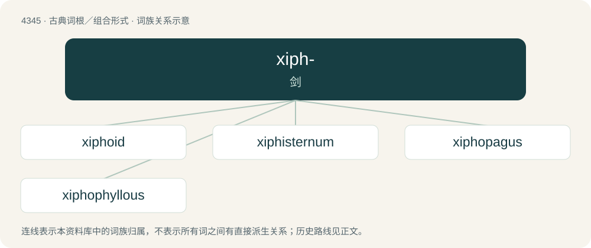

# 4345 · xiph- — 剑

[总目录](../00_总目录_按常用程度.md)

**类型**：古典词根／组合形式　｜　**来源语言**：古希腊语

## 核心含义与来源

- 核心含义：剑
- 英文含义：sword
- 词形：xiph-

**来源词形**：ξίφος (xíphos)

## 词族图

## 单词速览（常用到不常用）

| 单词 | 音标 | 释义 |
|---|---|---|
| [xiphoid](#w-1) | /ˈzɪfɔɪd/ | n. 剑突；a. 剑状的 |
| [xiphisternum](#w-2) | /,zifiˈstəːnəm/ | n. \[解\]\[动\]剑胸骨 |
| [xiphopagus](#w-3) |  | \[医\] 剑突联胎 |
| [xiphophyllous](#w-4) | /,zifəˈfiləs/ | a. \[植\]有剑状叶的 |

## 逐词详解

### 1. xiphoid

**词性**：形容词　｜　**音标**：/ˈzɪfɔɪd/

**中文释义**：n. 剑突；a. 剑状的

**英文义项**：Shaped like a sword, ensiform. / Of or relating to the xiphoid process (also called xiphisternum).

**词源与演化**：

From Ancient Greek ξιφοειδής (xiphoeidḗs, “sword-shaped”).

### 2. xiphisternum

**词性**：名词　｜　**音标**：/,zifiˈstəːnəm/

**中文释义**：n. \[解\]\[动\]剑胸骨

**英文义项**：Synonym of xiphoid process.

**词源与演化**：

Ancient Greek ξίφος (xíphos, “sword”) + English -i- (in place of the etymologically consistent -o-) + English sternum

### 3. xiphopagus

**词性**：形容词

**中文释义**：\[医\] 剑突联胎

**英文义项**：United at the xiphoid process.

**构词拆分**：xipho- + -pagus

**词源与演化**：

From xipho- + -pagus.

### 4. xiphophyllous

**词性**：形容词　｜　**音标**：/,zifəˈfiləs/

**中文释义**：a. \[植\]有剑状叶的

**英文义项**：Having sword-shaped leaves

**构词拆分**：xipho- + phyllous

**词源与演化**：

From xipho- + phyllous.
