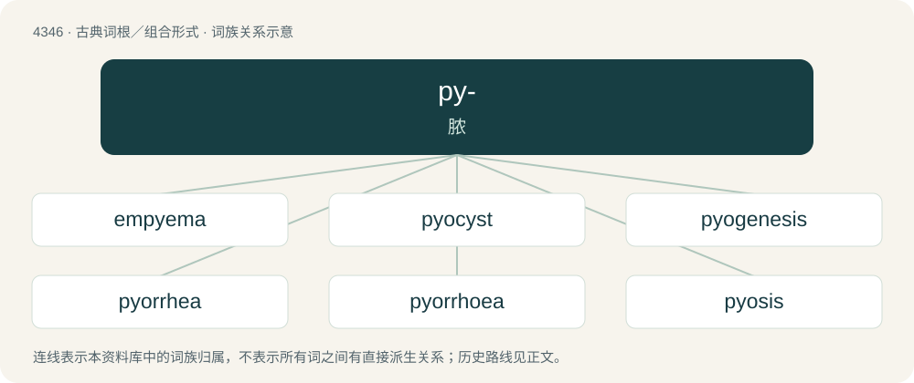

# 4346 · py- — 脓

[总目录](../00_总目录_按常用程度.md)

**类型**：古典词根／组合形式　｜　**来源语言**：古希腊语

## 核心含义与来源

- 核心含义：脓
- 英文含义：pus
- 词形：py-

**来源词形**：πύον (púon), (pyeîn)

## 词族图

## 单词速览（常用到不常用）

| 单词 | 音标 | 释义 |
|---|---|---|
| [empyema](#w-1) | 英 /ɛm.pʌɪˈiː.mə/；美 /ɛm.paɪˈiː.mə/ | n. 积脓症；\[医\] 积脓, 脓胸 |
| [pyocyst](#w-2) | /ˈpaiəsist/ | 脓囊肿 |
| [pyogenesis](#w-3) | /,paiəˈdʒenisis/ | n. \[医\]生脓,化脓 |
| [pyorrhea](#w-4) | /,paiəˈriə/ | n. \[医\]脓漏, 脓溢 |
| [pyorrhoea](#w-5) | /pʌɪəˈɹɪə/ | n. 脓溢 |
| [pyosis](#w-6) | /paiˈəusis/ | n. \[医\]化脓(症) |

## 逐词详解

### 1. empyema

**词性**：名词　｜　**音标**：英 /ɛm.pʌɪˈiː.mə/；美 /ɛm.paɪˈiː.mə/

**中文释义**：n. 积脓症；\[医\] 积脓, 脓胸

**英文义项**：A collection of pus within a naturally existing anatomical cavity (as opposed to an abscess, which occurs in a newly formed cavity).

**词源与演化**：

From Ancient Greek ἐμπύημα (empúēma, “gathering, abscess”).

### 2. pyocyst

**词性**：名词　｜　**音标**：/ˈpaiəsist/

**中文释义**：脓囊肿

**英文义项**：A cyst that contains pus

**构词拆分**：pyo- + cyst

**词源与演化**：

From pyo- + cyst.

### 3. pyogenesis

**词性**：名词　｜　**音标**：/,paiəˈdʒenisis/

**中文释义**：n. \[医\]生脓,化脓

**英文义项**：formation of pus

**构词拆分**：pyo- + -genesis

**词源与演化**：

From pyo- + -genesis.

### 4. pyorrhea

**词性**：名词　｜　**音标**：/,paiəˈriə/

**中文释义**：n. \[医\]脓漏, 脓溢

**英文义项**：An inflammation of the gums in which the teeth become loose; chronic periodontitis. / A discharge of pus.

**构词拆分**：pyo- + -rrhea

**词源与演化**：

From pyo- (“pus”) + -rrhea (“flow”).

### 5. pyorrhoea

**词性**：名词　｜　**音标**：/pʌɪəˈɹɪə/

**中文释义**：n. 脓溢

**英文义项**：Flowing or discharge of pus; periodontitis

**构词拆分**：pyo- + -rrhoea

**词源与演化**：

From pyo- + -rrhoea.

### 6. pyosis

**词性**：名词　｜　**音标**：/paiˈəusis/

**中文释义**：n. \[医\]化脓(症)

**英文义项**：formation of pus

**构词拆分**：pyo- + -osis

**词源与演化**：

From pyo- + -osis.

## 其他候选词

- pyemia
- pyemesis
- pyesis
- pyoureter
