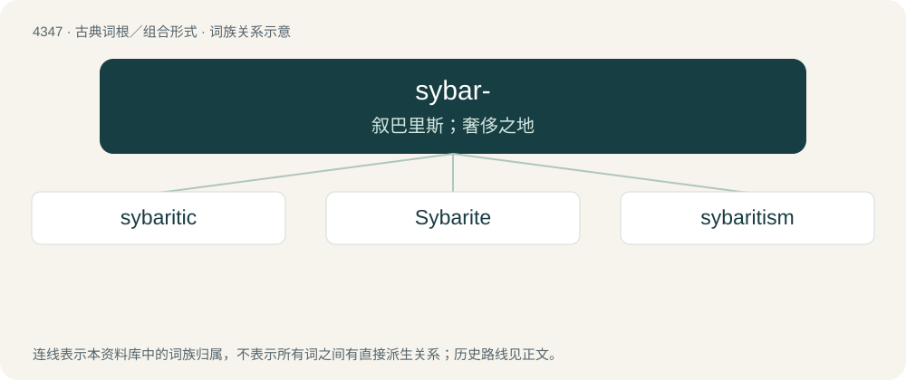

# 4347 · sybar- — 叙巴里斯；奢侈之地

[总目录](../00_总目录_按常用程度.md)

**类型**：古典词根／组合形式　｜　**来源语言**：古希腊语

## 核心含义与来源

- 核心含义：叙巴里斯；奢侈之地
- 英文含义：Sybaris
- 词形：sybar-

**来源词形**：Σύβαρις, συβάρεως, Συβαρίτης Sybarī́tēs, Συβαριτικός

## 词族图

## 单词速览（常用到不常用）

| 单词 | 音标 | 释义 |
|---|---|---|
| [sybaritic](#w-1) | 英 /ˌsɪbəˈɹɪtɪk/；美 /ˌsɪbəˈɹɪtɪk/ | a. 奢侈享乐的, 耽于奢侈逸乐的, 骄奢淫逸的 |
| [Sybarite](#w-2) | /ˈsɪbəɹaɪt/ | n. 爱奢侈享乐的人, 奢侈逸乐之徒, 骄奢淫逸的人 |
| [sybaritism](#w-3) | /ˈsibəraitizəm/ | n. 奢侈享乐, 骄奢淫逸 |

## 逐词详解

### 1. sybaritic

**词性**：形容词　｜　**音标**：英 /ˌsɪbəˈɹɪtɪk/；美 /ˌsɪbəˈɹɪtɪk/

**中文释义**：a. 奢侈享乐的, 耽于奢侈逸乐的, 骄奢淫逸的

**英文义项**：Of or having the qualities of a sybarite (“a person devoted to luxury and pleasure”); dedicated to excessive comfort and enjoyment; decadent, hedonistic, self-indulgent.

**构词拆分**：Sybarite (“inhabitant of Sybaris”) + -ic

**词源与演化**：

Learned borrowing from Latin Sybarīticus (“of or pertaining to Sybaris or its inhabitants”) + English -ic (suffix meaning ‘of or pertaining to’, forming adjectives from nouns). Sybarīticus is derived from Ancient Greek Συβαρῑτικός (Subarītikós), from Σῠβᾰρῑ́της (Sŭbărī́tēs, “(noun) inhabitant of Sybaris; (adjective) decadent; self-indulgent”) (from Σῠ́βᾰρῐς (Sŭ́bărĭs, “Sybaris”) + -ῑ́της (-ī́tēs, suffix forming demonyms)) + -κός (-kós, suffix meaning ‘of or pertaining to’, forming adjectives). The English word is analysable as Sybarite (“inhabitant of Sybaris”) + -ic. Sybaris, a city of Magna Graecia (the coastal parts of Sicily and southern Italy once colonized by Greek settlers), was known for its wealth and the excesses and hedonism of its inhabitants.

**例句**：

> A chinchilla robe of sybaritic lavishness.

该用例对应义项：displaying luxury and furnishing gratification to the senses

### 2. Sybarite

**词性**：名词　｜　**音标**：/ˈsɪbəɹaɪt/

**中文释义**：n. 爱奢侈享乐的人, 奢侈逸乐之徒, 骄奢淫逸的人

**英文义项**：A native or inhabitant of Sybaris.

**构词拆分**：Sybaris + -ite

**词源与演化**：

From Sybaris + -ite.

### 3. sybaritism

**词性**：名词　｜　**音标**：/ˈsibəraitizəm/

**中文释义**：n. 奢侈享乐, 骄奢淫逸

**英文义项**：luxury, wantonness, voluptuousness, or hedonism

**构词拆分**：sybarite + -ism

**词源与演化**：

From sybarite + -ism.
