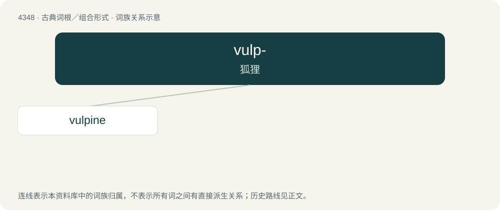

# 4348 · vulp- — 狐狸

[总目录](../00_总目录_按常用程度.md)

**类型**：古典词根／组合形式　｜　**来源语言**：拉丁语

## 核心含义与来源

- 核心含义：狐狸
- 英文含义：fox
- 词形：vulp-

**来源词形**：vulpēs, vulpis

## 词族图

## 单词速览（常用到不常用）

| 单词 | 音标 | 释义 |
|---|---|---|
| [vulpine](#w-1) | /ˈvʌlpaɪn/ | a. 狐狸的, 狐狸似的, 诡计多端的 |

## 逐词详解

### 1. vulpine

**词性**：形容词　｜　**音标**：/ˈvʌlpaɪn/

**中文释义**：a. 狐狸的, 狐狸似的, 诡计多端的

**英文义项**：Pertaining to a fox. / Having the characteristics of a fox; foxlike; cunning.

**词源与演化**：

Borrowed from Latin vulpīnus (“foxy, fox-like”), from vulpēs, earlier volpēs (“fox”), from Proto-Indo-European \*wl(o)p- (“fox”). Cognate with Welsh llywarn (“fox”), Ancient Greek ἀλώπηξ (alṓpēx), Armenian աղուէս (aġuēs), Albanian dhelpër, Lithuanian vilpišỹs (“wildcat”), Sanskrit लोपाश (lopāśa, “jackal, fox”).
