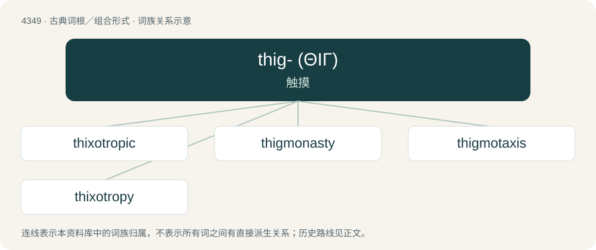

# 4349 · thig- (ΘΙΓ) — 触摸

[总目录](../00_总目录_按常用程度.md)

**类型**：古典词根／组合形式　｜　**来源语言**：古希腊语

## 核心含义与来源

- 核心含义：触摸
- 英文含义：touch
- 词形：thig-

**来源词形**：θιγγάνειν (thingánein), θίξις (thíxis), θίγημα (thígēma)

## 词族图

## 单词速览（常用到不常用）

| 单词 | 音标 | 释义 |
|---|---|---|
| [thixotropic](#w-1) | /,θiksəˈtrɔpik/ | a. \[化\]触变的,具有触变作用的, 摇溶的 |
| [thigmonasty](#w-2) | /,θi^məˈnæsti/ | 感触性 |
| [thigmotaxis](#w-3) | /ˈθi^məˈtæksis/ | n. \[生\]趋触性 |
| [thixotropy](#w-4) | /θikˈsɔtrəpi/ | n. 触变性, 摇溶现象, 摇溶；\[化\] 触变性 |

## 逐词详解

### 1. thixotropic

**词性**：形容词　｜　**音标**：/,θiksəˈtrɔpik/

**中文释义**：a. \[化\]触变的,具有触变作用的, 摇溶的

**英文义项**：Becoming a fluid when agitated but solid or semi-solid when allowed to stand.

**词源与演化**：

From Ancient Greek θίξις (thíxis, “touch”) + English -tropic.

### 2. thigmonasty

**词性**：名词　｜　**音标**：/,θi^məˈnæsti/

**中文释义**：感触性

**英文义项**：A nastic response to touch or vibration.

**构词拆分**：thigmo- + -nasty

**词源与演化**：

From thigmo- + -nasty.

### 3. thigmotaxis

**词性**：名词　｜　**音标**：/ˈθi^məˈtæksis/

**中文释义**：n. \[生\]趋触性

**英文义项**：The movement of an organism either towards or away from the stimulus of physical contact.

**构词拆分**：thigmo- + taxis

**词源与演化**：

From thigmo- + taxis.

### 4. thixotropy

**词性**：名词　｜　**音标**：/θikˈsɔtrəpi/

**中文释义**：n. 触变性, 摇溶现象, 摇溶；\[化\] 触变性

**英文义项**：The reduction of viscosity with increased shear / The property of certain gels whereby they become fluids when agitated and return to being solid or semi-solid when allowed to stand.

**构词拆分**：Ancient Greek θίξις (thíxis, “touching”) + Ancient Greek τροπή (tropḗ, “turning”, from τρέπω (trépō, “turn, change”)) + -y

**词源与演化**：

From Ancient Greek θίξις (thíxis, “touching”) + Ancient Greek τροπή (tropḗ, “turning”, from τρέπω (trépō, “turn, change”)) + -y.

## 其他候选词

- antithixotropic
