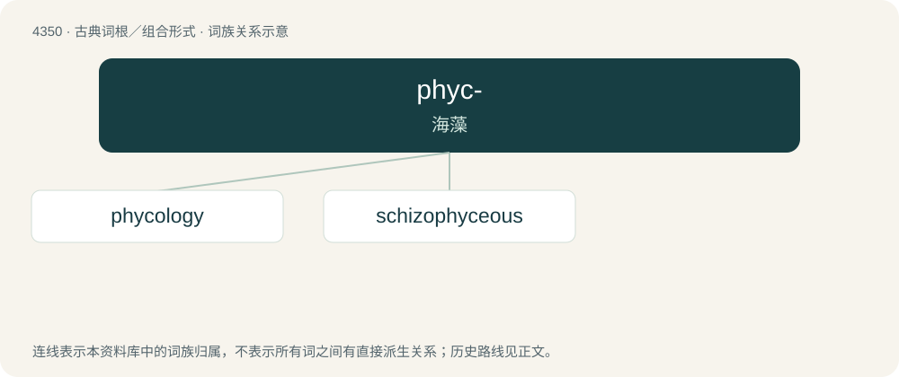

# 4350 · phyc- — 海藻

[总目录](../00_总目录_按常用程度.md)

**类型**：古典词根／组合形式　｜　**来源语言**：古希腊语

## 核心含义与来源

- 核心含义：海藻
- 英文含义：seaweed
- 词形：phyc-

**来源词形**：φῦκος, φύκεος (phûkos, phúkeos)

## 词族图

## 单词速览（常用到不常用）

| 单词 | 音标 | 释义 |
|---|---|---|
| [phycology](#w-1) | 英 /faɪˈkɒl.ə.d͡ʒɪ/；美 /faɪˈkɑ.lə.d͡ʒi/ | n. 藻类学 |
| [schizophyceous](#w-2) | /,skidzəjˈfiʃəs, ,skits-/ | a. \[微\]裂殖藻纲的 |

## 逐词详解

### 1. phycology

**词性**：名词　｜　**音标**：英 /faɪˈkɒl.ə.d͡ʒɪ/；美 /faɪˈkɑ.lə.d͡ʒi/

**中文释义**：n. 藻类学

**英文义项**：The scientific study of algae.

**构词拆分**：phyco- + -logy

**词源与演化**：

From phyco- + -logy.

### 2. schizophyceous

**词性**：形容词　｜　**音标**：/,skidzəjˈfiʃəs, ,skits-/

**中文释义**：a. \[微\]裂殖藻纲的

**英文义项**：Of or relating to the Schizophyceae, a class of blue-green algae.

**构词拆分**：Schizophyceae + -ous

**词源与演化**：

From Schizophyceae + -ous.

## 其他候选词

- Phycomyces
