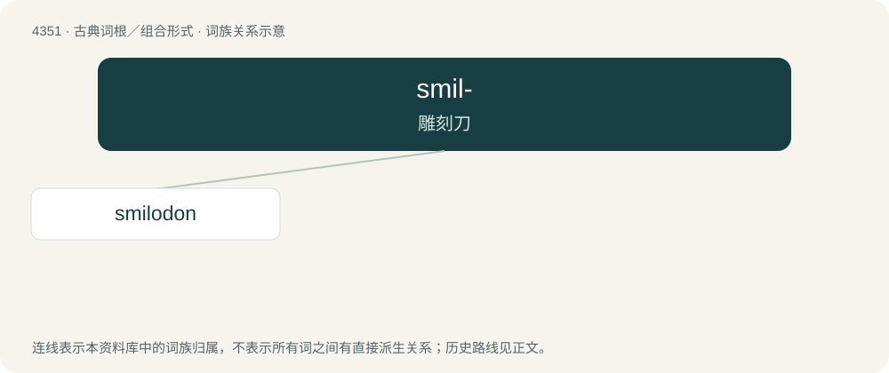

# 4351 · smil- — 雕刻刀

[总目录](../00_总目录_按常用程度.md)

**类型**：古典词根／组合形式　｜　**来源语言**：古希腊语

## 核心含义与来源

- 核心含义：雕刻刀
- 英文含义：carving knife
- 词形：smil-

**来源词形**：σμίλη (smílē), σμιλεύω, σμιλευτός, σμίλευμα

## 词族图

## 单词速览（常用到不常用）

| 单词 | 音标 | 释义 |
|---|---|---|
| [smilodon](#w-1) | /ˈsmailədɔn/ | n. \[古生\] (灭绝于冰川期的)剑齿虎 |

## 逐词详解

### 1. smilodon

**词性**：名词　｜　**音标**：/ˈsmailədɔn/

**中文释义**：n. \[古生\] (灭绝于冰川期的)剑齿虎

**英文义项**：Any member of the extinct genus Smilodon, the saber-toothed tigers.

**词源与演化**：

From the genus name Smilodon.
