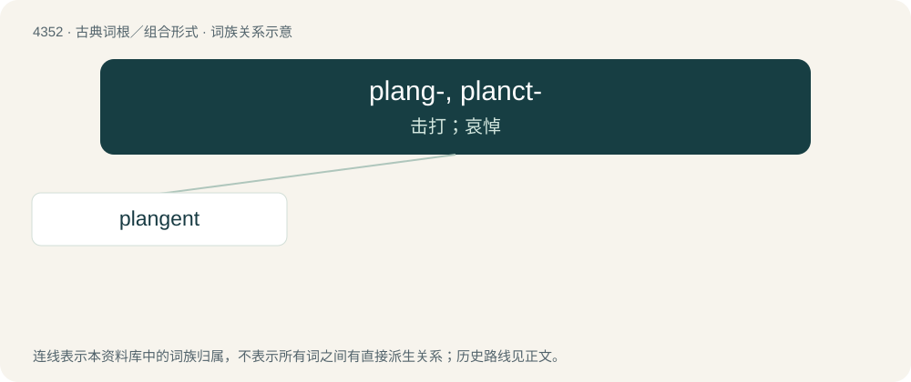

# 4352 · plang-, planct- — 击打；哀悼

[总目录](../00_总目录_按常用程度.md)

**类型**：古典词根／组合形式　｜　**来源语言**：拉丁语

## 核心含义与来源

- 核心含义：击打；哀悼
- 英文含义：strike, beat; lament, mourn
- 词形：plang-, planct-

**来源词形**：plangere, planctus

## 词族图

## 单词速览（常用到不常用）

| 单词 | 音标 | 释义 |
|---|---|---|
| [plangent](#w-1) | /ˈplænd͡ʒənt/ | a. 轰鸣的, 凄切的, 哀鸣的 |

## 逐词详解

### 1. plangent

**词性**：形容词　｜　**音标**：/ˈplænd͡ʒənt/

**中文释义**：a. 轰鸣的, 凄切的, 哀鸣的

**英文义项**：Having a loud, mournful sound. / Beating, dashing, as waves.

**词源与演化**：

From Latin plangēns, present participle of plangō (“to beat; to lament”).
