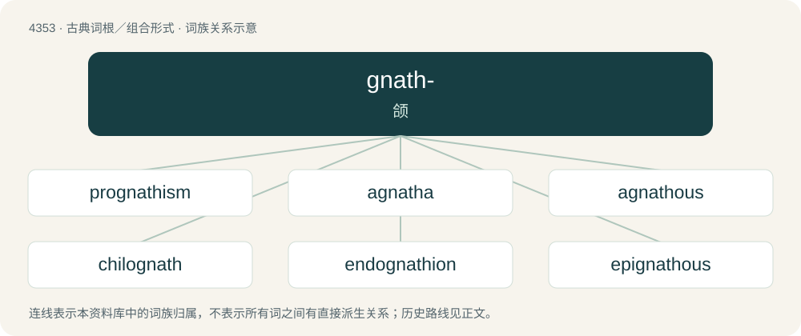

# 4353 · gnath- — 颌

[总目录](../00_总目录_按常用程度.md)

**类型**：古典词根／组合形式　｜　**来源语言**：古希腊语

## 核心含义与来源

- 核心含义：颌
- 英文含义：jaw
- 词形：gnath-

**来源词形**：γνάθος (gnáthos), γναθμός

## 词族图

## 单词速览（常用到不常用）

| 单词 | 音标 | 释义 |
|---|---|---|
| [prognathism](#w-1) | /ˈprɔ^nəθizəm, prɔ^ˈnei-/ | n. \[解\]凸颌,凸颚 |
| [agnatha](#w-2) | /ˈæɡ.nə.θə/ | 【英文】An agnathan. |
| [agnathous](#w-3) | /ˈæɡ.nə.θəs/ | a. 属无颚类的 |
| [chilognath](#w-4) |  | 【英文】Any of the subclass Chilognatha of the millipedes. |
| [endognathion](#w-5) |  | \[医\] 内颌(切牙骨内部) |
| [epignathous](#w-6) | /iˈpi^nəθəs/ | \[动\]长上颚的 |
| [gnathic](#w-7) | 英 /ˈɡnæθɪk/ | a. 颚的, 颌的；\[医\] 颌的 |
| [hypognathous](#w-8) | /haiˈpɔ^nəθəs/ | a. \[动\]下口式的 |
| [hystricognath](#w-9) |  | 【英文】Any member of the infraorder Hystricognathi of rodents, distinguished from other rodents by the bone structure of their skulls. |
| [mesognathous](#w-10) |  | \[医\] 中型颌的, 切牙骨的 |

## 逐词详解

### 1. prognathism

**词性**：名词　｜　**音标**：/ˈprɔ^nəθizəm, prɔ^ˈnei-/

**中文释义**：n. \[解\]凸颌,凸颚

**英文义项**：An abnormal projection of the jaws.

**构词拆分**：pro- + -gnathism

**词源与演化**：

From pro- + -gnathism, after prognathous and prognathic.

### 2. agnatha

**词性**：名词　｜　**音标**：/ˈæɡ.nə.θə/

**英文义项**：An agnathan.

**词源与演化**：

From Agnatha, from Ancient Greek ἀ- (a-, “without”) + γνάθος (gnáthos, “jaw”).

### 3. agnathous

**词性**：形容词　｜　**音标**：/ˈæɡ.nə.θəs/

**中文释义**：a. 属无颚类的

**英文义项**：Jawless. / Afflicted by or characteristic of agnathia.

**构词拆分**：a- + -gnathous

**词源与演化**：

From Ancient Greek ἀ- (a-, “without”) + Ancient Greek γνάθος (gnáthos, “jaw”) + -ous, equivalent to a- + -gnathous.

### 4. chilognath

**词性**：名词

**英文义项**：Any of the subclass Chilognatha of the millipedes.

### 5. endognathion

**词性**：名词

**中文释义**：\[医\] 内颌(切牙骨内部)

**英文义项**：A craniometric point in the inner segment of the premaxilla

**构词拆分**：endo- + gnathion

**词源与演化**：

From endo- + gnathion.

### 6. epignathous

**词性**：形容词　｜　**音标**：/iˈpi^nəθəs/

**中文释义**：\[动\]长上颚的

**英文义项**：hook-billed; having the upper mandible longer than the lower one

**构词拆分**：epi- + -gnathous

**词源与演化**：

From epi- + -gnathous.

### 7. gnathic

**词性**：形容词　｜　**音标**：英 /ˈɡnæθɪk/

**中文释义**：a. 颚的, 颌的；\[医\] 颌的

**英文义项**：Of or pertaining to the jaw.

**构词拆分**：gnath- (“jaw”) + -ic

**词源与演化**：

From gnath- (“jaw”) + -ic.

### 8. hypognathous

**词性**：形容词　｜　**音标**：/haiˈpɔ^nəθəs/

**中文释义**：a. \[动\]下口式的

**英文义项**：Having the maxilla, or lower jaw, longer than the upper jaw.

**构词拆分**：hypo- + -gnathous

**词源与演化**：

From hypo- + -gnathous.

### 9. hystricognath

**词性**：名词

**英文义项**：Any member of the infraorder Hystricognathi of rodents, distinguished from other rodents by the bone structure of their skulls.

### 10. mesognathous

**词性**：形容词

**中文释义**：\[医\] 中型颌的, 切牙骨的

**英文义项**：having the jaws slightly projecting; between prognathous and orthognathous

**构词拆分**：meso- + -gnathous

**词源与演化**：

From meso- + -gnathous.

## 其他候选词

- compsognathus
- exognathion
- gnathophyma
- mesognathion
