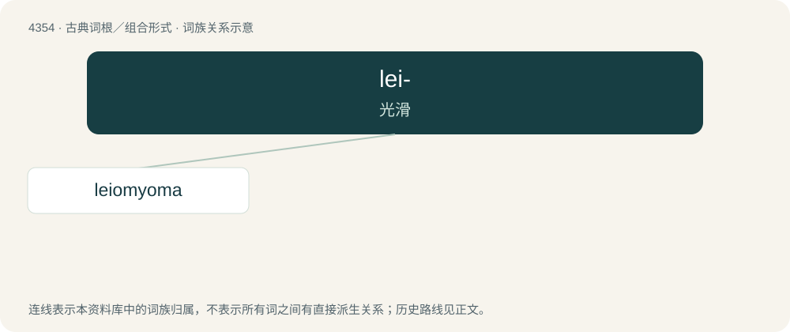

# 4354 · lei- — 光滑

[总目录](../00_总目录_按常用程度.md)

**类型**：古典词根／组合形式　｜　**来源语言**：古希腊语

## 核心含义与来源

- 核心含义：光滑
- 英文含义：smooth
- 词形：lei-

**来源词形**：λεῖος (leîos)

## 词族图

## 单词速览（常用到不常用）

| 单词 | 音标 | 释义 |
|---|---|---|
| [leiomyoma](#w-1) | /,laiəumaiˈəumə/ | n. \[医\] 平滑肌瘤 |

## 逐词详解

### 1. leiomyoma

**词性**：名词　｜　**音标**：/,laiəumaiˈəumə/

**中文释义**：n. \[医\] 平滑肌瘤

**英文义项**：A non-cancerous tumor of smooth muscle

**构词拆分**：From leio- + myoma.

**词源与演化**：

From leio- + myoma.
