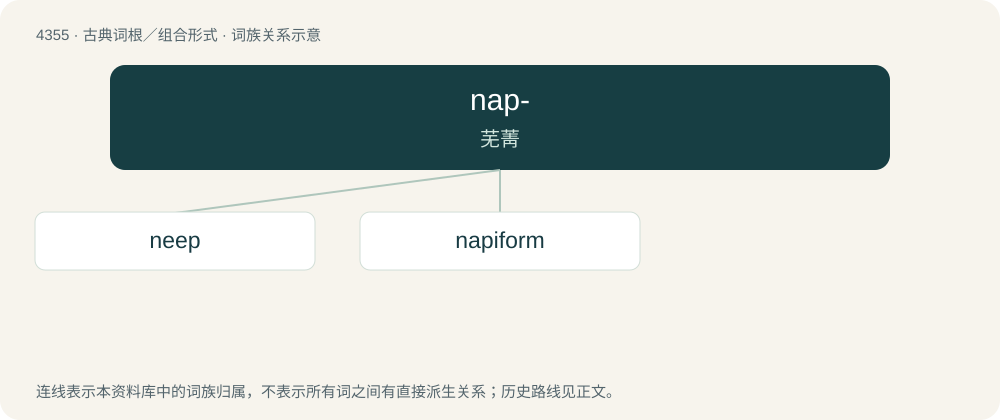

# 4355 · nap- — 芜菁

[总目录](../00_总目录_按常用程度.md)

**类型**：古典词根／组合形式　｜　**来源语言**：拉丁语

## 核心含义与来源

- 核心含义：芜菁
- 英文含义：turnip
- 词形：nap-

**来源词形**：nāpus

## 词族图

## 单词速览（常用到不常用）

| 单词 | 音标 | 释义 |
|---|---|---|
| [neep](#w-1) | /niːp/ | n. &lt;英方&gt;萝卜 |
| [napiform](#w-2) | 英 /ˈneɪp.ɪ.fɔːm/；美 /ˈneɪ.pɪ.fɔɹm/ | \[植\](根部)芜菁状的,上部粗圆下部细长 |

## 逐词详解

### 1. neep

**词性**：名词　｜　**音标**：/niːp/

**中文释义**：n. &lt;英方&gt;萝卜

**英文义项**：The swede (rutabaga); turnip.

**词源与演化**：

From Middle English neep, from Old English nǣp (“turnip, rape”), borrowed from Latin nāpus. Compare Icelandic næpa (“turnip”). Cognate with English turnip.

### 2. napiform

**词性**：形容词　｜　**音标**：英 /ˈneɪp.ɪ.fɔːm/；美 /ˈneɪ.pɪ.fɔɹm/

**中文释义**：\[植\](根部)芜菁状的,上部粗圆下部细长

**英文义项**：Shaped like a turnip; spherical at the top, but with a tapering bottom.

**词源与演化**：

From Latin nāpus (“turnip”) + -form.
