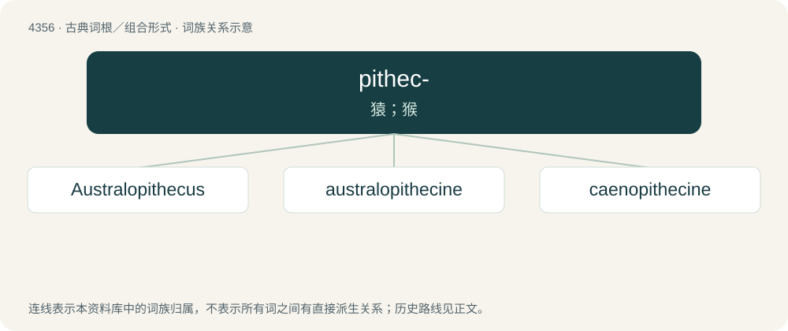

# 4356 · pithec- — 猿；猴

[总目录](../00_总目录_按常用程度.md)

**类型**：古典词根／组合形式　｜　**来源语言**：古希腊语

## 核心含义与来源

- 核心含义：猿；猴
- 英文含义：ape, monkey
- 词形：pithec-

**来源词形**：πίθηκος (píthēkos)

## 词族图

## 单词速览（常用到不常用）

| 单词 | 音标 | 释义 |
|---|---|---|
| [Australopithecus](#w-1) | /ˌɒstɹələˈpɪθɪkəs/ | n. \[古生\]南(方古)猿 |
| [australopithecine](#w-2) | 英 /ˌɒstɹələ(ʊ)ˈpɪθɪsiːn/ | n. 更新纪灵长动物；a. 更新纪灵长动物的 |
| [caenopithecine](#w-3) |  | 【英文】Any extinct primate of the subfamily Caenopithecinae |

## 逐词详解

### 1. Australopithecus

**词性**：名词　｜　**音标**：/ˌɒstɹələˈpɪθɪkəs/

**中文释义**：n. \[古生\]南(方古)猿

**英文义项**：Synonym of australopith.

**词源与演化**：

From the genus name Australopithecus.

**例句**：

> Australopithecus was an ancestor of humans.

### 2. australopithecine

**词性**：名词　｜　**音标**：英 /ˌɒstɹələ(ʊ)ˈpɪθɪsiːn/

**中文释义**：n. 更新纪灵长动物；a. 更新纪灵长动物的

**英文义项**：Any of several extinct hominids, belonging to the genera Australopithecus and Paranthropus in the subtribe Australopithecina when seen as distinct, and sometimes other closely related genera.

**词源与演化**：

Originally in reference to a now-obsolete subfamily Australopithecinae, formed in New Latin, from Latin austrālis (“southern”) + Ancient Greek πίθηκος (píthēkos, “ape”).

### 3. caenopithecine

**词性**：名词

**英文义项**：Any extinct primate of the subfamily Caenopithecinae
