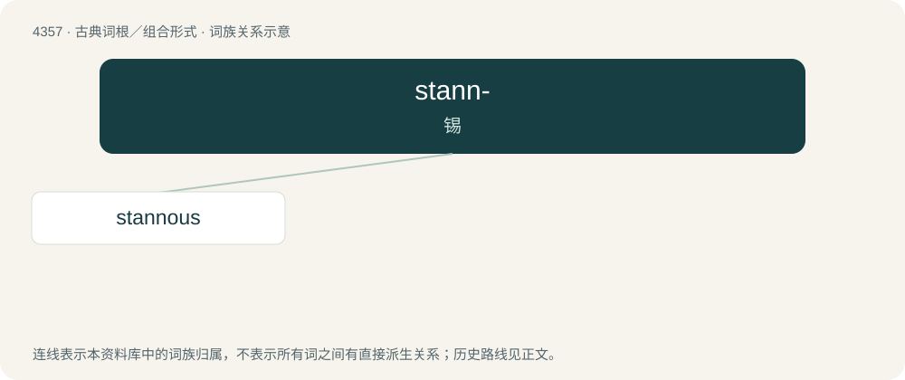

# 4357 · stann- — 锡

[总目录](../00_总目录_按常用程度.md)

**类型**：古典词根／组合形式　｜　**来源语言**：拉丁语

## 核心含义与来源

- 核心含义：锡
- 英文含义：tin
- 词形：stann-

**来源词形**：stannum

## 词族图

## 单词速览（常用到不常用）

| 单词 | 音标 | 释义 |
|---|---|---|
| [stannous](#w-1) | /ˈstænəs/ | a. 亚锡的, 含二价锡的；\[化\] 亚锡的; 二价锡的 |

## 逐词详解

### 1. stannous

**词性**：形容词　｜　**音标**：/ˈstænəs/

**中文释义**：a. 亚锡的, 含二价锡的；\[化\] 亚锡的; 二价锡的

**英文义项**：Containing bivalent tin.

**构词拆分**：stann- + -ous

**词源与演化**：

From stann- + -ous, from Latin stannum.
