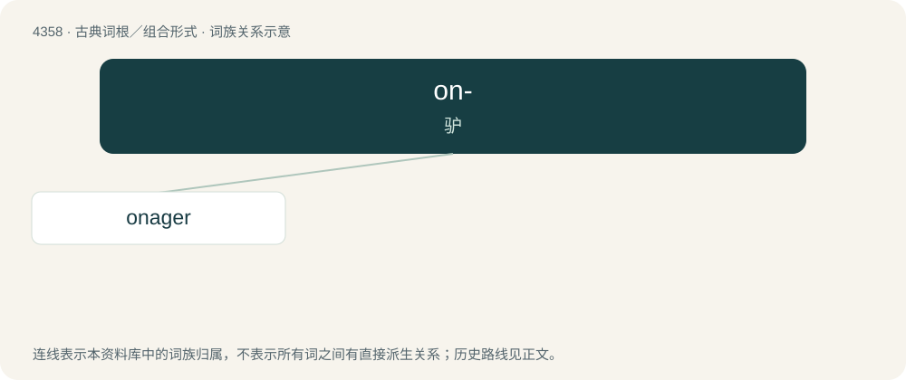

# 4358 · on- — 驴

[总目录](../00_总目录_按常用程度.md)

**类型**：古典词根／组合形式　｜　**来源语言**：古希腊语

## 核心含义与来源

- 核心含义：驴
- 英文含义：ass
- 词形：on-

**来源词形**：ὄνος (ónos), ὀνίσκος (onískos)

## 词族图

## 单词速览（常用到不常用）

| 单词 | 音标 | 释义 |
|---|---|---|
| [onager](#w-1) | 英 /ˈɒnəd͡ʒə/；美 /ˈɑnəd͡ʒɚ/ | n. 中亚野驴, 弩炮 |

## 逐词详解

### 1. onager

**词性**：名词　｜　**音标**：英 /ˈɒnəd͡ʒə/；美 /ˈɑnəd͡ʒɚ/

**中文释义**：n. 中亚野驴, 弩炮

**英文义项**：The Asiatic wild ass or hemione (Equus hemionus), an animal of the horse family native to Asia; specifically, the Persian onager, Persian wild ass, or Persian zebra (Equus hemionus onager). / A military engine acting like a sling which threw stones from a bag or wooden bucket powered by the torsion from a bundle of ropes or sinews operated by machinery; a torsion catapult.

**词源与演化**：

From Middle English onager, onagir (“wild ass; military catapult”), from Anglo-Norman onager, Middle French onager, onagre, Old French onager, onagre (“wild ass; military catapult”) (modern French onagre), from Late Latin onager (“large siege engine”), Latin onager (“wild ass”), from Hellenistic Ancient Greek ὄναγρος (ónagros, “wild ass”), Byzantine Ancient Greek ὄναγρος (ónagros, “large siege engine”), from ὄνος (ónos, “ass”) + ἄγριος (ágrios, “wild”) (from ᾰ̓γρός (ăgrós, “countryside; field”) (possibly ultimately from Proto-Indo-European \*h₂eǵ- (“to drive”)) + -ῐος (-ĭos, suffix forming adjectives)). The “military engine” sense alludes to the strong recoil of the engine, likened to an onager’s kick; see the 2007 quotation.

## 其他候选词

- Oniscidea
- Oniscomorpha
