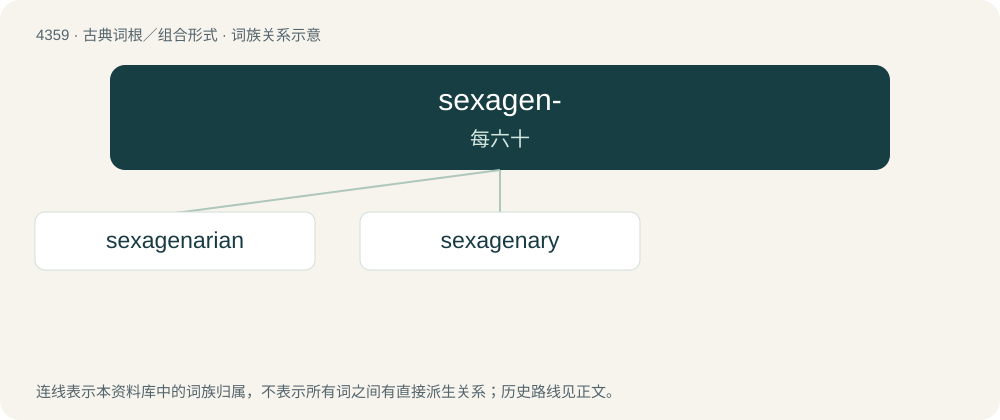

# 4359 · sexagen- — 每六十

[总目录](../00_总目录_按常用程度.md)

**类型**：古典词根／组合形式　｜　**来源语言**：拉丁语

## 核心含义与来源

- 核心含义：每六十
- 英文含义：sixty each
- 词形：sexagen-

**来源词形**：sexageni

## 词族图

## 单词速览（常用到不常用）

| 单词 | 音标 | 释义 |
|---|---|---|
| [sexagenarian](#w-1) | 英 /ˌsɛksəd͡ʒɪˈnɛəɹɪən/；美 /ˌsɛksəd͡ʒɪˈnɛɹiən/ | a. 六十岁到六十九岁的 |
| [sexagenary](#w-2) | 英 /ˌsɛksəˈd͡ʒiːnɹi/；美 /ˌsɛksəˈd͡ʒɛnəɹi/ | a. 六十的, 六十到六十九岁的；n. 六十到六十九岁的人 |

## 逐词详解

### 1. sexagenarian

**词性**：名词　｜　**音标**：英 /ˌsɛksəd͡ʒɪˈnɛəɹɪən/；美 /ˌsɛksəd͡ʒɪˈnɛɹiən/

**中文释义**：a. 六十岁到六十九岁的

**英文义项**：Synonym of sixtysomething: a person between 60 and 69 years old.

**词源与演化**：

From Latin sexāgēnārius (“containing 60”) + -an (forming adjectives and representative nouns), either directly or via French sexagénaire, from Latin sexāgēnus (“60 each”) + -ārius (“-ary”), from sexāgintā (“six tens, 60”).

### 2. sexagenary

**词性**：形容词　｜　**音标**：英 /ˌsɛksəˈd͡ʒiːnɹi/；美 /ˌsɛksəˈd͡ʒɛnəɹi/

**中文释义**：a. 六十的, 六十到六十九岁的；n. 六十到六十九岁的人

**英文义项**：Containing sixty years. / Synonym of sexagenarian: lasting or aged sixty years; sixty-year-old.

**词源与演化**：

From Latin sexāgēnārius (“sixty; sixty years old; a sixty-year-old”) either directly or via French sexagénaire, from Latin sexāgēnus (“60 each”), from sexaginta (“six tens, sixty”). Cognate with sexagenarian.
