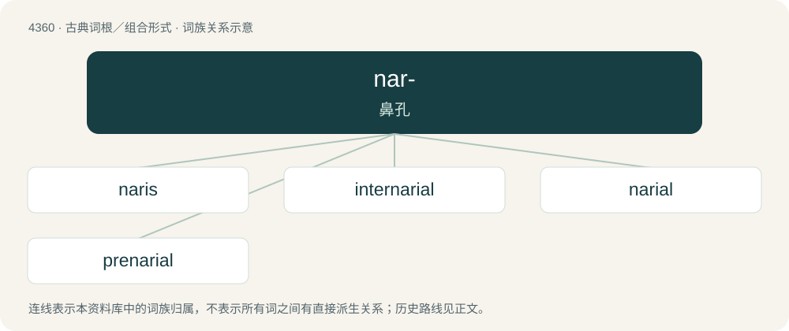

# 4360 · nar- — 鼻孔

[总目录](../00_总目录_按常用程度.md)

**类型**：古典词根／组合形式　｜　**来源语言**：拉丁语

## 核心含义与来源

- 核心含义：鼻孔
- 英文含义：nostril
- 词形：nar-

**来源词形**：naris

## 词族图

## 单词速览（常用到不常用）

| 单词 | 音标 | 释义 |
|---|---|---|
| [naris](#w-1) | /ˈnɛə.ɹɪs/ | n. 鼻孔；\[医\] 鼻孔 |
| [internarial](#w-2) | 英 /ˌɪn.təˈnɛəɹi.əl/；美 /ˌɪntɚˈnɛɹi.əl/ | \[医\] 鼻孔间的 |
| [narial](#w-3) | 英 /ˈnɛəɹi.əl/；美 /ˈnɛɹi.əl/ | a. \[解\]鼻孔的 |
| [prenarial](#w-4) | 英 /pɹiːˈnɛəɹi.əl/；美 /pɹiˈnɛɹi.əl/ | 【英文】Situated in front of the nares |

## 逐词详解

### 1. naris

**词性**：名词　｜　**音标**：/ˈnɛə.ɹɪs/

**中文释义**：n. 鼻孔；\[医\] 鼻孔

**英文义项**：a nostril

**词源与演化**：

From Latin naris (“nostril”). Itself from Latin nāsus with rhotacism.

### 2. internarial

**词性**：形容词　｜　**音标**：英 /ˌɪn.təˈnɛəɹi.əl/；美 /ˌɪntɚˈnɛɹi.əl/

**中文释义**：\[医\] 鼻孔间的

**英文义项**：Between the nares.

**构词拆分**：inter- + narial

**词源与演化**：

From inter- + narial.

### 3. narial

**词性**：形容词　｜　**音标**：英 /ˈnɛəɹi.əl/；美 /ˈnɛɹi.əl/

**中文释义**：a. \[解\]鼻孔的

**英文义项**：Relating to, or located at or near, the nares

### 4. prenarial

**词性**：形容词　｜　**音标**：英 /pɹiːˈnɛəɹi.əl/；美 /pɹiˈnɛɹi.əl/

**英文义项**：Situated in front of the nares

**构词拆分**：pre- + narial

**词源与演化**：

From pre- + narial.

## 其他候选词

- nares
