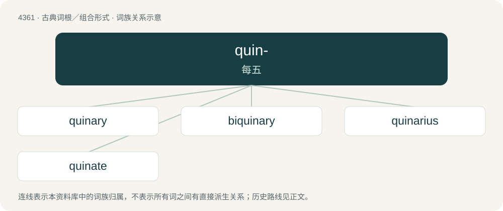

# 4361 · quin- — 每五

[总目录](../00_总目录_按常用程度.md)

**类型**：古典词根／组合形式　｜　**来源语言**：拉丁语

## 核心含义与来源

- 核心含义：每五
- 英文含义：five each
- 词形：quin-

**来源词形**：quini

## 词族图

## 单词速览（常用到不常用）

| 单词 | 音标 | 释义 |
|---|---|---|
| [quinary](#w-1) | /ˈkwaɪ.nə.ɹi/ | a. 五的, 五个组成的, 五进制的；\[计\] 五进制的 |
| [biquinary](#w-2) | /baiˈkwainəri/ | \[计\] 二五混合进制的 |
| [quinarius](#w-3) | 英 /kwɪˈnɛəɹi.əs/；美 /kwɪˈnɛɹi.əs/ | 【英文】A small silver coin minted during the Roman Republic, equal to half of a denarius. |
| [quinate](#w-4) | 英 /ˈkwaɪnət/；美 /ˈkwaɪˌneɪt/ | n. \[化\]奎尼酸；a. 具有五小叶的, 由五枚小叶片组成的 |

## 逐词详解

### 1. quinary

**词性**：形容词　｜　**音标**：/ˈkwaɪ.nə.ɹi/

**中文释义**：a. 五的, 五个组成的, 五进制的；\[计\] 五进制的

**英文义项**：Of fifth rank or order. / Consisting of five things; arranged in fives.

**词源与演化**：

From the Latin quīnārius (“containing five each”), from quīnī (“five each”, “five at a time”) + -ārius (whence the English suffix -ary); compare the French quinaire, the Italian quinario, and the Portuguese quinário. Doublet of quinarius.

### 2. biquinary

**词性**：形容词　｜　**音标**：/baiˈkwainəri/

**中文释义**：\[计\] 二五混合进制的

**英文义项**：Employing, or relating to, an arithmetical system and notation in which each decimal digit is represented by a coefficient of five and a coefficient of one

**构词拆分**：bi- + quinary

**词源与演化**：

From bi- + quinary.

### 3. quinarius

**词性**：名词　｜　**音标**：英 /kwɪˈnɛəɹi.əs/；美 /kwɪˈnɛɹi.əs/

**英文义项**：A small silver coin minted during the Roman Republic, equal to half of a denarius.

**词源与演化**：

Borrowed from Latin quinarius.

### 4. quinate

**词性**：形容词　｜　**音标**：英 /ˈkwaɪnət/；美 /ˈkwaɪˌneɪt/

**中文释义**：n. \[化\]奎尼酸；a. 具有五小叶的, 由五枚小叶片组成的

**英文义项**：Featuring five leaflets growing from a single point; quinquefoliolate.

**词源与演化**：

First attested in 1760. From the post-Classical Latin quīnātus, from the distributive numeral quīnī (“five each”, “five at a time”); compare binate, ternate, and quaternate, as well as the French quiné.
