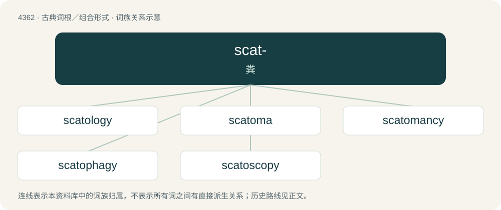

# 4362 · scat- — 粪

[总目录](../00_总目录_按常用程度.md)

**类型**：古典词根／组合形式　｜　**来源语言**：古希腊语

## 核心含义与来源

- 核心含义：粪
- 英文含义：dung
- 词形：scat-

**来源词形**：σκῶρ, σκατός (skôr, skatós)

## 词族图

## 单词速览（常用到不常用）

| 单词 | 音标 | 释义 |
|---|---|---|
| [scatology](#w-1) | /skəˈtɒlədʒi/ | n. 粪化石学, 粪便学, 色情文学；\[医\] 粪便学 |
| [scatoma](#w-2) | /skəˈtəumə/ | n. \[医\]粪结,粪瘤(指肠内积粪) |
| [scatomancy](#w-3) |  | 【英文】divination by the examination of feces, especially of an animal |
| [scatophagy](#w-4) | /skəˈtɔfədʒi/ | 食粪的 |
| [scatoscopy](#w-5) | /skəˈtɔskəpi/ | n. \[医\]粪便检视法 |

## 逐词详解

### 1. scatology

**词性**：名词　｜　**音标**：/skəˈtɒlədʒi/

**中文释义**：n. 粪化石学, 粪便学, 色情文学；\[医\] 粪便学

**英文义项**：The scientific study or chemical analysis of faeces. / A filthy epithet.

**词源与演化**：

From Ancient Greek σκῶρ (skôr, “excrement”) + -ology.

**例句**：

> It really sucks when scatology turns to eschatology, or the other way round.

### 2. scatoma

**词性**：名词　｜　**音标**：/skəˈtəumə/

**中文释义**：n. \[医\]粪结,粪瘤(指肠内积粪)

**英文义项**：Synonym of fecaloma.

**词源与演化**：

By surface analysis, scat- + -oma.

### 3. scatomancy

**词性**：名词

**英文义项**：divination by the examination of feces, especially of an animal

**构词拆分**：scato- + -mancy

**词源与演化**：

From scato- + -mancy.

### 4. scatophagy

**词性**：名词　｜　**音标**：/skəˈtɔfədʒi/

**中文释义**：食粪的

**英文义项**：Synonym of coprophagy.

**构词拆分**：scato- + -phagy

**词源与演化**：

From scato- + -phagy.

### 5. scatoscopy

**词性**：名词　｜　**音标**：/skəˈtɔskəpi/

**中文释义**：n. \[医\]粪便检视法

**英文义项**：Synonym of scatomancy (“divination by examining feces”). / Examination of the feces for diagnostic purposes.

**构词拆分**：scato- + -scopy

**词源与演化**：

From scato- + -scopy.

## 其他候选词

- scatemia
