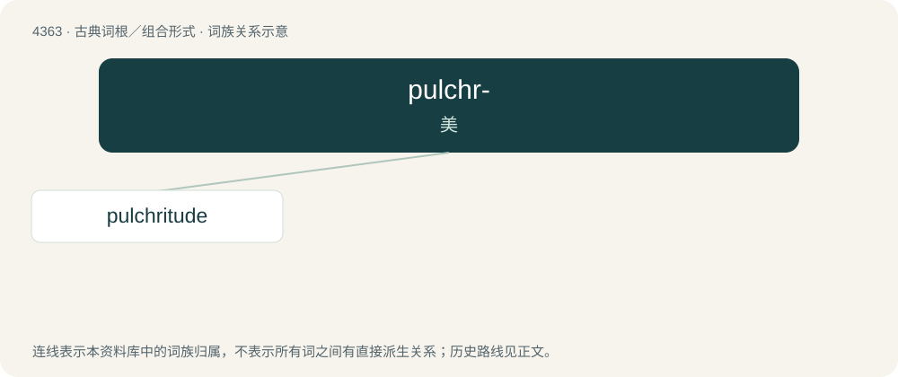

# 4363 · pulchr- — 美

[总目录](../00_总目录_按常用程度.md)

**类型**：古典词根／组合形式　｜　**来源语言**：拉丁语

## 核心含义与来源

- 核心含义：美
- 英文含义：beautiful
- 词形：pulchr-

**来源词形**：pulcher, pulchri

## 词族图

## 单词速览（常用到不常用）

| 单词 | 音标 | 释义 |
|---|---|---|
| [pulchritude](#w-1) | /pʌlkrə.t(j)uːd/ | n. 美丽 |

## 逐词详解

### 1. pulchritude

**词性**：名词　｜　**音标**：/pʌlkrə.t(j)uːd/

**中文释义**：n. 美丽

**英文义项**：Physical beauty.

**词源与演化**：

From Middle English pulcritude, from Latin pulchritūdō, from pulcher (“beautiful”).
