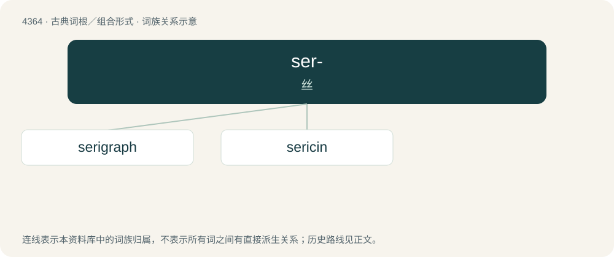

# 4364 · ser- — 丝

[总目录](../00_总目录_按常用程度.md)

**类型**：古典词根／组合形式　｜　**来源语言**：古希腊语

## 核心含义与来源

- 核心含义：丝
- 英文含义：silk
- 词形：ser-

**来源词形**：σήρ (sḗr), σηρικός

## 词族图

## 单词速览（常用到不常用）

| 单词 | 音标 | 释义 |
|---|---|---|
| [serigraph](#w-1) | /ˈsɛɹɪɡɹæf/ | n. 绢网印花 |
| [sericin](#w-2) | /ˈserisin/ | n. 丝胶；\[化\] 丝胶蛋白 |

## 逐词详解

### 1. serigraph

**词性**：名词　｜　**音标**：/ˈsɛɹɪɡɹæf/

**中文释义**：n. 绢网印花

**英文义项**：a silkscreen print made by serigraphy / an autographic device to test the strength of raw silk

**词源与演化**：

From Latin sericum (“silk”) + -graph.

### 2. sericin

**词性**：名词　｜　**音标**：/ˈserisin/

**中文释义**：n. 丝胶；\[化\] 丝胶蛋白

**英文义项**：A water-soluble glycoprotein that binds the two fibroin filaments of a silk fibre.

**词源与演化**：

From a derivative of Latin sēricus.
