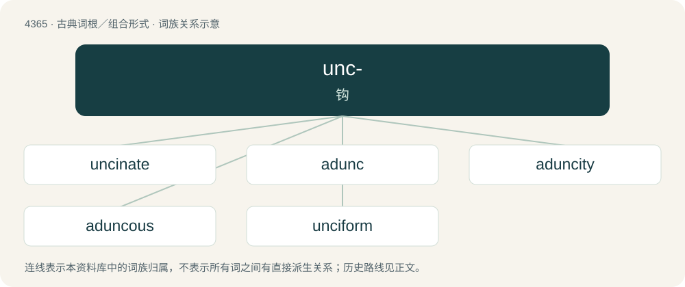

# 4365 · unc- — 钩

[总目录](../00_总目录_按常用程度.md)

**类型**：古典词根／组合形式　｜　**来源语言**：拉丁语

## 核心含义与来源

- 核心含义：钩
- 英文含义：hook
- 词形：unc-

**来源词形**：uncus

## 词族图

## 单词速览（常用到不常用）

| 单词 | 音标 | 释义 |
|---|---|---|
| [uncinate](#w-1) | /ˈʌnsinit/ | a. 钩状的；\[医\] 钩状的, 有钩的; 钩回的 |
| [adunc](#w-2) | /ˈæ.dʌnk/ | a. 向内弯曲的 |
| [aduncity](#w-3) | /əˈdʌŋsiti/ | n. adunc的变形 |
| [aduncous](#w-4) | /əˈdʌŋkəs/ | a. 向内弯曲的 |
| [unciform](#w-5) | 英 /ˈʌnsɪfɔːm/；美 /ˈʌnsɪfɔːɹm/ | a. 钩状的, 钩骨的；n. 钩骨 |

## 逐词详解

### 1. uncinate

**词性**：形容词　｜　**音标**：/ˈʌnsinit/

**中文释义**：a. 钩状的；\[医\] 钩状的, 有钩的; 钩回的

**英文义项**：Hooked at the end. / Hooked in form; possessing a hook.

**词源与演化**：

From Latin uncīnātus, from uncīnus (“hook, barb”).

### 2. adunc

**词性**：形容词　｜　**音标**：/ˈæ.dʌnk/

**中文释义**：a. 向内弯曲的

**英文义项**：Curved inward, hooked.

**词源与演化**：

Borrowed from Latin aduncus.

### 3. aduncity

**词性**：名词　｜　**音标**：/əˈdʌŋsiti/

**中文释义**：n. adunc的变形

**英文义项**：Crookedness, curvaceousness, hookedness.

**词源与演化**：

From Latin aduncitās (“hookedness”), from aduncus + -itās. By surface analysis, adunc + -ity.

### 4. aduncous

**词性**：形容词　｜　**音标**：/əˈdʌŋkəs/

**中文释义**：a. 向内弯曲的

**英文义项**：curved inwards; hooked

### 5. unciform

**词性**：形容词　｜　**音标**：英 /ˈʌnsɪfɔːm/；美 /ˈʌnsɪfɔːɹm/

**中文释义**：a. 钩状的, 钩骨的；n. 钩骨

**英文义项**：Of the shape of a hook; hook-shaped.

**词源与演化**：

From Latin uncus (“hook”) + -form.

## 其他候选词

- Uncinaria
- Uncinia
