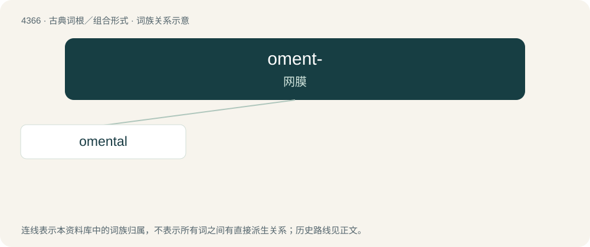

# 4366 · oment- — 网膜

[总目录](../00_总目录_按常用程度.md)

**类型**：古典词根／组合形式　｜　**来源语言**：拉丁语

## 核心含义与来源

- 核心含义：网膜
- 英文含义：fat skin
- 词形：oment-

**来源词形**：omentum

## 词族图

## 单词速览（常用到不常用）

| 单词 | 音标 | 释义 |
|---|---|---|
| [omental](#w-1) | /əuˈmentəl/ | a. \[解\]网膜的 |

## 逐词详解

### 1. omental

**词性**：形容词　｜　**音标**：/əuˈmentəl/

**中文释义**：a. \[解\]网膜的

**英文义项**：Of or pertaining to an omentum or the omenta.

**构词拆分**：omentum + -al

**词源与演化**：

From omentum + -al.

**用法示例／搭配（非完整句）**：

> omental transposition

该用例对应义项：Of or pertaining to an omentum or the omenta.
