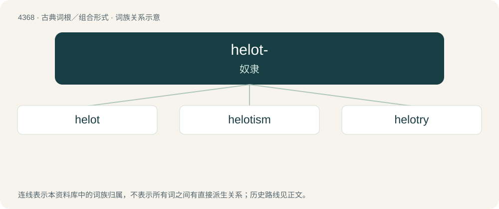

# 4368 · helot- — 奴隶

[总目录](../00_总目录_按常用程度.md)

**类型**：古典词根／组合形式　｜　**来源语言**：古希腊语

## 核心含义与来源

- 核心含义：奴隶
- 英文含义：enslaved
- 词形：helot-

**来源词形**：Εἵλως, Εἵλωτος, Εἱλώτης

## 词族图

## 单词速览（常用到不常用）

| 单词 | 音标 | 释义 |
|---|---|---|
| [helot](#w-1) | /ˈhɛlət/ | n. 希洛人(古斯巴达奴隶), 奴隶, 农奴 |
| [helotism](#w-2) | /ˈhelətizm/ | n. 古斯巴达的奴隶制度, 奴隶的身分 |
| [helotry](#w-3) | /ˈhelətri/ | n. 奴隶阶级 |

## 逐词详解

### 1. helot

**词性**：名词　｜　**音标**：/ˈhɛlət/

**中文释义**：n. 希洛人(古斯巴达奴隶), 奴隶, 农奴

**英文义项**：A member of the ancient Spartan class of serfs. / A serf; a slave.

**词源与演化**：

From Latin Hīlōta, from Ancient Greek Εἵλωτες (Heílōtes), possibly from ἁλίσκομαι (halískomai, “to be captured, to be made prisoner”) or from Ἕλος (Hélos, “Elos”), a Laconian town.

### 2. helotism

**词性**：名词　｜　**音标**：/ˈhelətizm/

**中文释义**：n. 古斯巴达的奴隶制度, 奴隶的身分

**英文义项**：The permanent oppression of a nominally free group of people / A form of mutualism in which one species is forced to perform tasks for another, for their mutual benefit

**构词拆分**：helot + -ism

**词源与演化**：

From helot + -ism.

### 3. helotry

**词性**：名词　｜　**音标**：/ˈhelətri/

**中文释义**：n. 奴隶阶级

**英文义项**：Collectively, the helots (slaves or bondsmen).

**构词拆分**：helot + -ry

**词源与演化**：

From helot + -ry.
