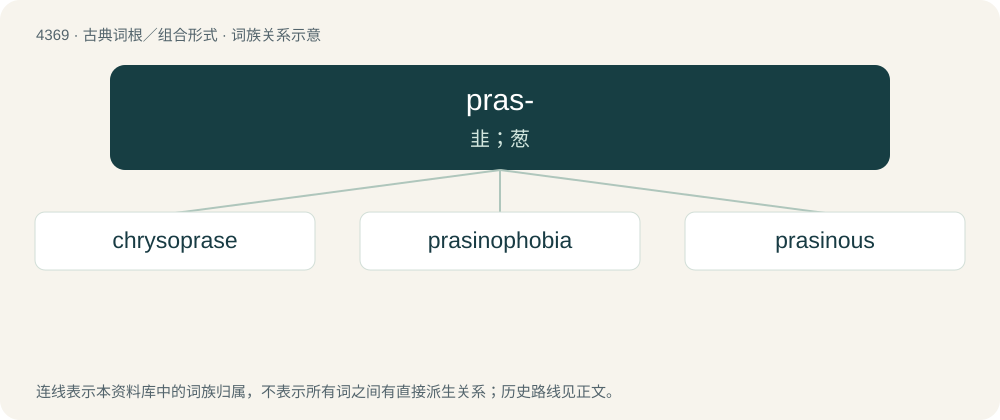

# 4369 · pras- — 韭；葱

[总目录](../00_总目录_按常用程度.md)

**类型**：古典词根／组合形式　｜　**来源语言**：古希腊语

## 核心含义与来源

- 核心含义：韭；葱
- 英文含义：leek
- 词形：pras-

**来源词形**：πράσον (práson), πράσινος (prásinos) "leek-green", πρασιά

## 词族图

## 单词速览（常用到不常用）

| 单词 | 音标 | 释义 |
|---|---|---|
| [chrysoprase](#w-1) | /ˈkɹɪsəˌpɹeɪz/ | n. 绿玉髓；\[化\] 绿玉髓 |
| [prasinophobia](#w-2) |  | 【英文】Fear of, or aversion to, the colour green. |
| [prasinous](#w-3) | /prəˈsɪnəs/ | 草绿色 |

## 逐词详解

### 1. chrysoprase

**词性**：名词　｜　**音标**：/ˈkɹɪsəˌpɹeɪz/

**中文释义**：n. 绿玉髓；\[化\] 绿玉髓

**英文义项**：A variety of light-green translucent quartz.

**词源与演化**：

From Ancient Greek χρῡσόπρασος (khrūsóprasos).

### 2. prasinophobia

**词性**：名词

**英文义项**：Fear of, or aversion to, the colour green.

**构词拆分**：Ancient Greek πράσῐνος (prásĭnos) + -o- + -phobia

**词源与演化**：

From Ancient Greek πράσῐνος (prásĭnos) + -o- + -phobia.

### 3. prasinous

**词性**：形容词　｜　**音标**：/prəˈsɪnəs/

**中文释义**：草绿色

**英文义项**：Of a clear, light green color.

**词源与演化**：

From Latin prasinus, from Ancient Greek πρᾰ́σῐνος (prắsĭnos, “leek-green, light green”).
