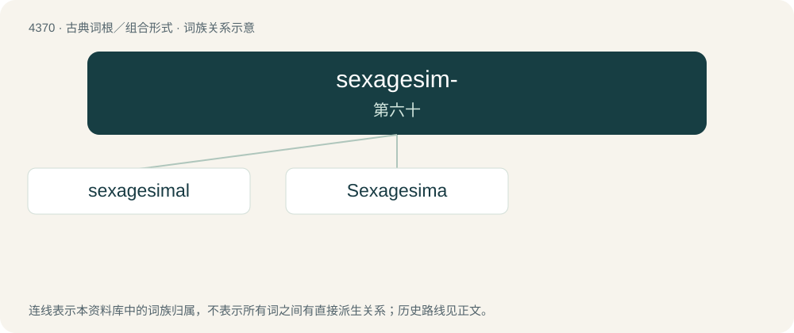

# 4370 · sexagesim- — 第六十

[总目录](../00_总目录_按常用程度.md)

**类型**：古典词根／组合形式　｜　**来源语言**：拉丁语

## 核心含义与来源

- 核心含义：第六十
- 英文含义：sixtieth
- 词形：sexagesim-

**来源词形**：sexagesimus

## 词族图

## 单词速览（常用到不常用）

| 单词 | 音标 | 释义 |
|---|---|---|
| [sexagesimal](#w-1) | /ˌsɛk.səˈdʒɛ.sɪ.məl/ | a. 六十的, 六十进制的；n. 以60为分母的分数 |
| [Sexagesima](#w-2) | /,seksəˈdʒesimə/ | n. 四旬斋前的第二个星期日 |

## 逐词详解

### 1. sexagesimal

**词性**：形容词　｜　**音标**：/ˌsɛk.səˈdʒɛ.sɪ.məl/

**中文释义**：a. 六十的, 六十进制的；n. 以60为分母的分数

**英文义项**：Of, related to, or based on the number sixty.

**词源与演化**：

From Medieval Latin sexagesimalis, from sexāgēsimus (“sixtieth”) + -ālis (“-al”), from sexāgintā (“sixty”). Cognate with sexagenary and sexagenarian. Cf. sextal.

**例句**：

> The common English divisions of time, longitude, and latitude are all computed using sexagesimal arithmetic.

该用例对应义项：Of, related to, or based on the number sixty.

### 2. Sexagesima

**词性**：名词　｜　**音标**：/,seksəˈdʒesimə/

**中文释义**：n. 四旬斋前的第二个星期日

**英文义项**：In the Christian calendar the Sunday two weeks before Lent, eight before Easter Sunday.

**词源与演化**：

from Latin sexagesima dies, from the feminine of sexagesimus '60th' + dies 'day'
