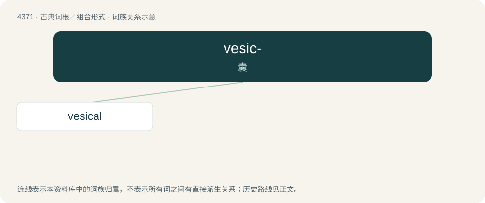

# 4371 · vesic- — 囊

[总目录](../00_总目录_按常用程度.md)

**类型**：古典词根／组合形式　｜　**来源语言**：拉丁语

## 核心含义与来源

- 核心含义：囊
- 英文含义：bladder
- 词形：vesic-

**来源词形**：vesica

## 词族图

## 单词速览（常用到不常用）

| 单词 | 音标 | 释义 |
|---|---|---|
| [vesical](#w-1) | /ˈvɛsɪkəl/ | a. 膀胱的, 椭圆形的 |

## 逐词详解

### 1. vesical

**词性**：形容词　｜　**音标**：/ˈvɛsɪkəl/

**中文释义**：a. 膀胱的, 椭圆形的

**英文义项**：Pertaining to the urinary bladder.

**词源与演化**：

From Latin vesica (“bladder”). By surface analysis, vesic- + -al.
