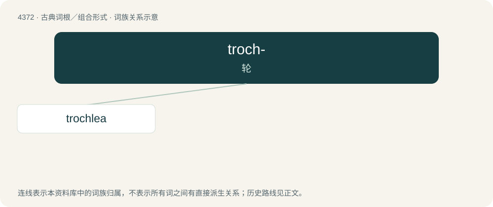

# 4372 · troch- — 轮

[总目录](../00_总目录_按常用程度.md)

**类型**：古典词根／组合形式　｜　**来源语言**：古希腊语

## 核心含义与来源

- 核心含义：轮
- 英文含义：wheel
- 词形：troch-

**来源词形**：τροχός (trokhós)

## 词族图

## 单词速览（常用到不常用）

| 单词 | 音标 | 释义 |
|---|---|---|
| [trochlea](#w-1) | 英 /ˈtɹɒk.li.ə/；美 /ˈtɹɑk.li.ə/ | n. 滑车；\[医\] 滑车 |

## 逐词详解

### 1. trochlea

**词性**：名词　｜　**音标**：英 /ˈtɹɒk.li.ə/；美 /ˈtɹɑk.li.ə/

**中文释义**：n. 滑车；\[医\] 滑车

**英文义项**：In the elbow joint, the articular surface of the lower extremity of the humerus, grasped by the trochlear notch of the ulna. / A pulley-like cartilage through which the superior oblique muscle of the eyeball passes.

**词源与演化**：

Borrowed from Latin trochlea (“case or sheaf containing one or more pulleys, block”).
