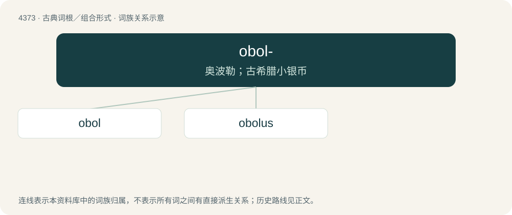

# 4373 · obol- — 奥波勒；古希腊小银币

[总目录](../00_总目录_按常用程度.md)

**类型**：古典词根／组合形式　｜　**来源语言**：古希腊语

## 核心含义与来源

- 核心含义：奥波勒；古希腊小银币
- 词形：obol-

**来源词形**：ὀβολός, ὀβολοῦ (obolós, oboloû)

## 词族图

## 单词速览（常用到不常用）

| 单词 | 音标 | 释义 |
|---|---|---|
| [obol](#w-1) | 英 /ˈɒ.bɒl/；美 /ˈɑ.bəl/ | n. 奥波勒斯(古希腊银币) |
| [obolus](#w-2) | /ˈɔbləs/ | \[拉\]欧布鲁斯(①古希腊价值1／6德拉克马的硬币 ②现行希腊重量单位(合0.1克) ③以前欧洲通用的小硬币) |

## 逐词详解

### 1. obol

**词性**：名词　｜　**音标**：英 /ˈɒ.bɒl/；美 /ˈɑ.bəl/

**中文释义**：n. 奥波勒斯(古希腊银币)

**英文义项**：Synonym of obolus: a silver coin of Ancient Greece. / Synonym of obolus: a weight, equivalent to one sixth of a drachma.

**词源与演化**：

Borrowed from Ancient Greek ὀβολός (obolós, literally “spit”). Doublet of obole and pul.

**例句**：

> In Classical Athens, there were six obols to one drachma.

该用例对应义项：Synonym of obolus: a silver coin of Ancient Greece.

### 2. obolus

**词性**：名词　｜　**音标**：/ˈɔbləs/

**中文释义**：\[拉\]欧布鲁斯(①古希腊价值1／6德拉克马的硬币 ②现行希腊重量单位(合0.1克) ③以前欧洲通用的小硬币)

**英文义项**：A silver coin minted in Ancient Greece, valued at a sixth of a drachma. / A unit of weight, equal to one-sixth of a drachma.

**词源与演化**：

From Latin obolus, from Ancient Greek ὀβολός (obolós), from ὀβελός (obelós). Doublet of obole and pul.
