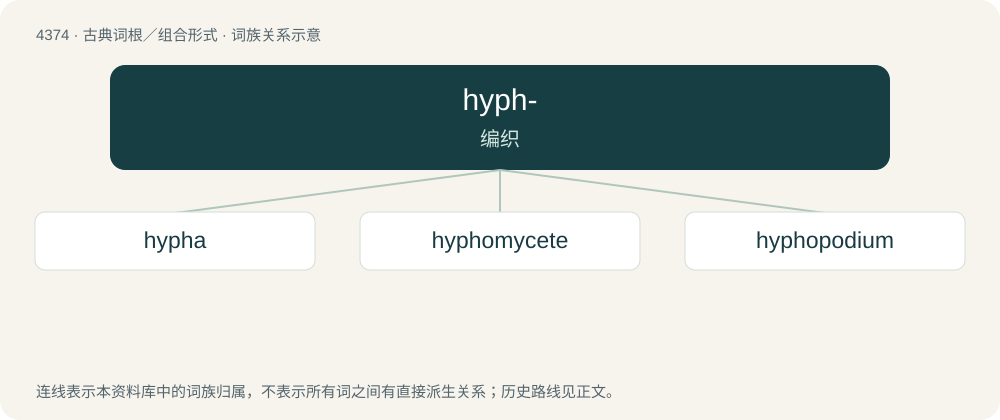

# 4374 · hyph- — 编织

[总目录](../00_总目录_按常用程度.md)

**类型**：古典词根／组合形式　｜　**来源语言**：古希腊语

## 核心含义与来源

- 核心含义：编织
- 英文含义：weave
- 词形：hyph-

**来源词形**：ὑφαίνειν (huphaínein), ὕφασμα, ὑφή (huphḗ) "web"

## 词族图

## 单词速览（常用到不常用）

| 单词 | 音标 | 释义 |
|---|---|---|
| [hypha](#w-1) | /ˈhaɪfə/ | n. \[植\]菌丝 |
| [hyphomycete](#w-2) |  | \[医\] 丝状菌 |
| [hyphopodium](#w-3) |  | 附着枝 |

## 逐词详解

### 1. hypha

**词性**：名词　｜　**音标**：/ˈhaɪfə/

**中文释义**：n. \[植\]菌丝

**英文义项**：Any of the long, threadlike filaments that form the mycelium of a fungus.

**词源与演化**：

From New Latin hypha, from Ancient Greek ὑφή (huphḗ, “web”).

### 2. hyphomycete

**词性**：名词

**中文释义**：\[医\] 丝状菌

**英文义项**：Any of a group of fungi imperfecti that lack fruiting bodies.

### 3. hyphopodium

**词性**：名词

**中文释义**：附着枝

**英文义项**：A hypha, in some ectoparasitic fungi, having a haustorium

**构词拆分**：From hypha + -podium (“leg-like structure”).

**词源与演化**：

From hypha + -podium (“leg-like structure”).
