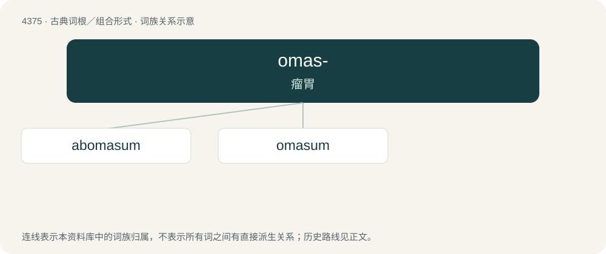

# 4375 · omas- — 瘤胃

[总目录](../00_总目录_按常用程度.md)

**类型**：古典词根／组合形式　｜　**来源语言**：拉丁语

## 核心含义与来源

- 核心含义：瘤胃
- 英文含义：paunch
- 词形：omas-

**来源词形**：omasum

## 词族图

## 单词速览（常用到不常用）

| 单词 | 音标 | 释义 |
|---|---|---|
| [abomasum](#w-1) | 美 /ˌæb.oʊˈmeɪ.səm/ | n. 皱胃(反刍动物胃的第四部分) |
| [omasum](#w-2) | 美 /oʊˈmeɪsəm/ | n. 重瓣胃；\[医\] 重瓣胃(反刍类的第三胃) |

## 逐词详解

### 1. abomasum

**词性**：名词　｜　**音标**：美 /ˌæb.oʊˈmeɪ.səm/

**中文释义**：n. 皱胃(反刍动物胃的第四部分)

**英文义项**：The fourth digestive compartment of the stomach of a cow or other ruminant, after the omasum; / the lining of said compartment, considered as a foodstuff.

**词源与演化**：

From New Latin abomāsum, from ab- (“away from”) + omāsum (“tripe of a bullock”).

### 2. omasum

**词性**：名词　｜　**音标**：美 /oʊˈmeɪsəm/

**中文释义**：n. 重瓣胃；\[医\] 重瓣胃(反刍类的第三胃)

**英文义项**：The third compartment of the stomach of a ruminant; the lining of said compartment, regarded as a foodstuff.

**词源与演化**：

Learned borrowing from Latin omāsum.
