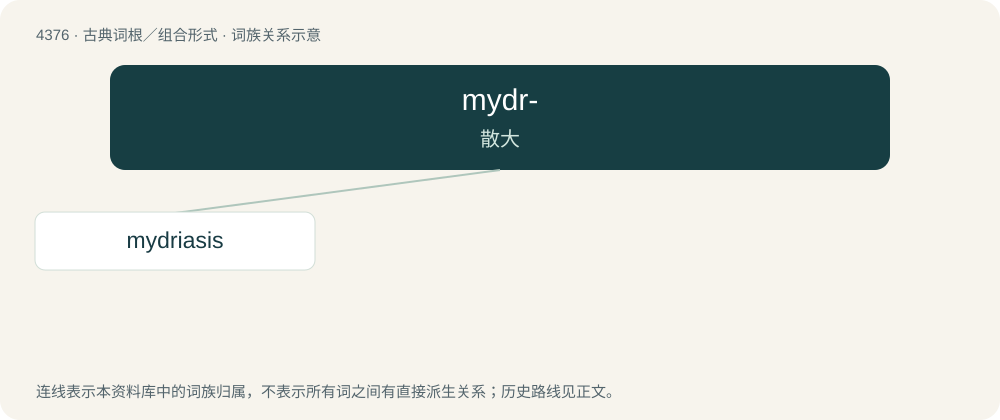

# 4376 · mydr- — 散大

[总目录](../00_总目录_按常用程度.md)

**类型**：古典词根／组合形式　｜　**来源语言**：古希腊语

## 核心含义与来源

- 核心含义：散大
- 英文含义：dilate
- 词形：mydr-

**来源词形**：μύδρος, μυδρίασις (mudríasis)

## 词族图

## 单词速览（常用到不常用）

| 单词 | 音标 | 释义 |
|---|---|---|
| [mydriasis](#w-1) | /mɪˈdɹaɪ ə sɪs/ | n. 瞳孔放大；\[医\] 瞳孔开大, 瞳孔散大, 瞳孔扩大 |

## 逐词详解

### 1. mydriasis

**词性**：名词　｜　**音标**：/mɪˈdɹaɪ ə sɪs/

**中文释义**：n. 瞳孔放大；\[医\] 瞳孔开大, 瞳孔散大, 瞳孔扩大

**英文义项**：The condition of having abnormally large and dilated pupils due to illness or narcotics, particularly stimulants such as methamphetamine, cocaine, etc.

**词源与演化**：

From Latin mydriasis, from Ancient Greek μυδρίᾱσις (mudríāsis, “undue enlargement of the pupil”), from μύδρος (múdros, “mass of red hot material in a forge”), possibly because the pupil is particularly bright or sparkling when dilated, or because of the red eye effect when exposed to a flash of light.
