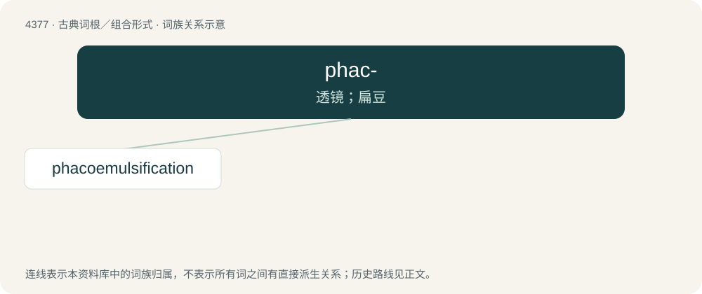

# 4377 · phac- — 透镜；扁豆

[总目录](../00_总目录_按常用程度.md)

**类型**：古典词根／组合形式　｜　**来源语言**：古希腊语

## 核心含义与来源

- 核心含义：透镜；扁豆
- 英文含义：lens
- 词形：phac-

**来源词形**：φακός (phakós)

## 词族图

## 单词速览（常用到不常用）

| 单词 | 音标 | 释义 |
|---|---|---|
| [phacoemulsification](#w-1) | /fəkəʊemʌlsɪfɪˈkeɪʃn/ | \[医\]晶状体乳化（法） |

## 逐词详解

### 1. phacoemulsification

**词性**：名词　｜　**音标**：/fəkəʊemʌlsɪfɪˈkeɪʃn/

**中文释义**：\[医\]晶状体乳化（法）

**英文义项**：A form of cataract surgery in which the eye's internal lens is emulsified with an ultrasonic handpiece and aspirated from the eye. Aspirated fluids are replaced with irrigation of balanced salt solution, thus maintaining the anterior chamber, as well as cooling the handpiece.

**构词拆分**：phaco- + emulsification

**词源与演化**：

From phaco- + emulsification.

## 其他候选词

- Phacochoerus
