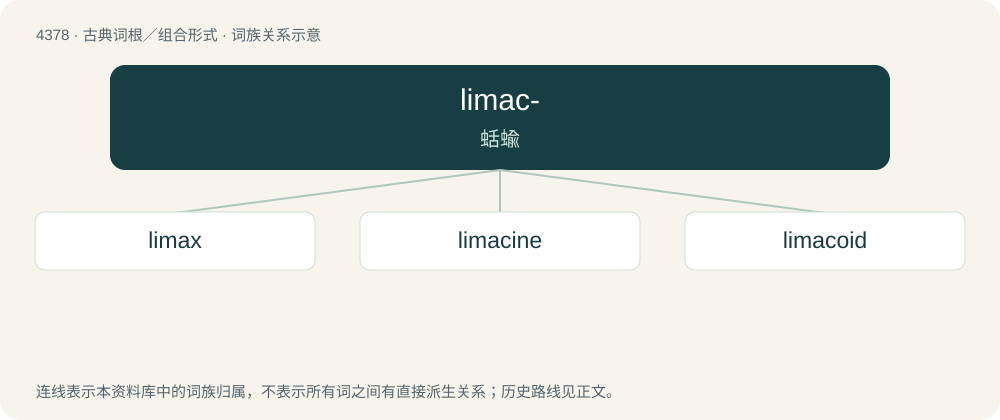

# 4378 · limac- — 蛞蝓

[总目录](../00_总目录_按常用程度.md)

**类型**：古典词根／组合形式　｜　**来源语言**：拉丁语

## 核心含义与来源

- 核心含义：蛞蝓
- 英文含义：slug
- 词形：limac-

**来源词形**：limax, limacis

## 词族图

## 单词速览（常用到不常用）

| 单词 | 音标 | 释义 |
|---|---|---|
| [limax](#w-1) |  | \[医\]蛞蝓属 |
| [limacine](#w-2) | /ˈlimə,sain, ˈlaimə-, -sin/ | a. \[动\]蛞蝓的, 似蛞蝓的 |
| [limacoid](#w-3) |  | \[网络\] 类风湿 |

## 逐词详解

### 1. limax

**词性**：名词

**中文释义**：\[医\]蛞蝓属

**英文义项**：A slug or slug-like creature.

### 2. limacine

**词性**：形容词　｜　**音标**：/ˈlimə,sain, ˈlaimə-, -sin/

**中文释义**：a. \[动\]蛞蝓的, 似蛞蝓的

**英文义项**：Characteristic of slugs of the subfamily Limacinae.

**词源与演化**：

Borrowed from Translingual Limacinae.

### 3. limacoid

**词性**：名词

**中文释义**：\[网络\] 类风湿

**英文义项**：A slug of the family Limacidae.

## 其他候选词

- limacon
