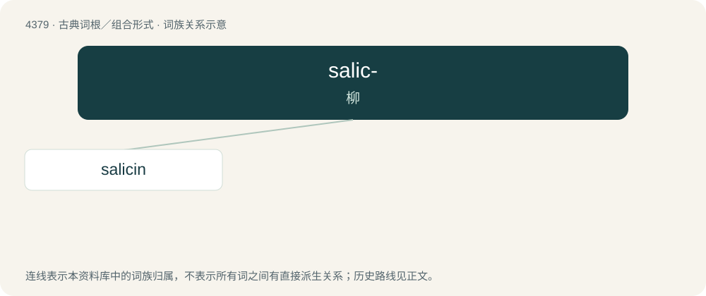

# 4379 · salic- — 柳

[总目录](../00_总目录_按常用程度.md)

**类型**：古典词根／组合形式　｜　**来源语言**：拉丁语

## 核心含义与来源

- 核心含义：柳
- 英文含义：willow
- 词形：salic-

**来源词形**：salix, salicis

## 词族图

## 单词速览（常用到不常用）

| 单词 | 音标 | 释义 |
|---|---|---|
| [salicin](#w-1) | /ˈsælisin/ | n. 水杨苷；\[化\] 水杨苷 |

## 逐词详解

### 1. salicin

**词性**：名词　｜　**音标**：/ˈsælisin/

**中文释义**：n. 水杨苷；\[化\] 水杨苷

**英文义项**：A glucoside derivative of salicylic acid; the active principle of willow bark, once used medicinally.

**词源与演化**：

From Latin salix, salicis (“a willow”) + -in.
