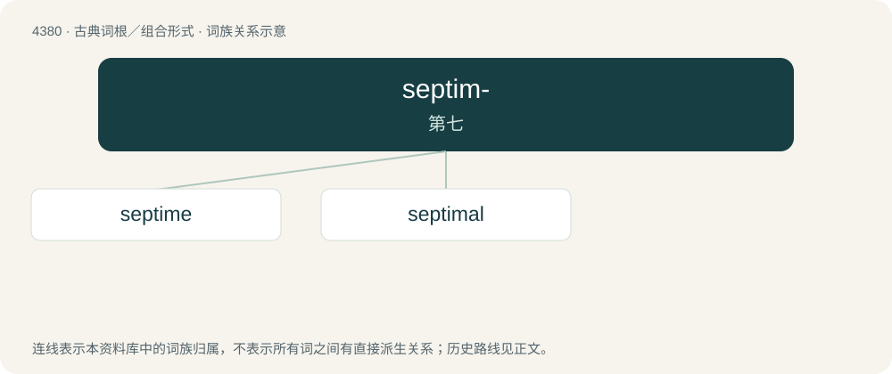

# 4380 · septim- — 第七

[总目录](../00_总目录_按常用程度.md)

**类型**：古典词根／组合形式　｜　**来源语言**：拉丁语

## 核心含义与来源

- 核心含义：第七
- 英文含义：seventh
- 词形：septim-

**来源词形**：septimus

## 词族图

## 单词速览（常用到不常用）

| 单词 | 音标 | 释义 |
|---|---|---|
| [septime](#w-1) | /ˈseptiːm/ | n. (击剑中的)第七姿势 |
| [septimal](#w-2) | /ˈseptiməl/ | a. 七的 |

## 逐词详解

### 1. septime

**词性**：名词　｜　**音标**：/ˈseptiːm/

**中文释义**：n. (击剑中的)第七姿势

**英文义项**：The seventh defensive position, with the sword hand held at waist height, and the tip of the sword at knee level.

**词源与演化**：

From French septime. By surface analysis, sept- + -ime.

### 2. septimal

**词性**：形容词　｜　**音标**：/ˈseptiməl/

**中文释义**：a. 七的

**英文义项**：Relating to the number seven. / Using base seven; septenary.

**词源与演化**：

From both Latin septimus + -al and By surface analysis, sept- + -ime + -al.
