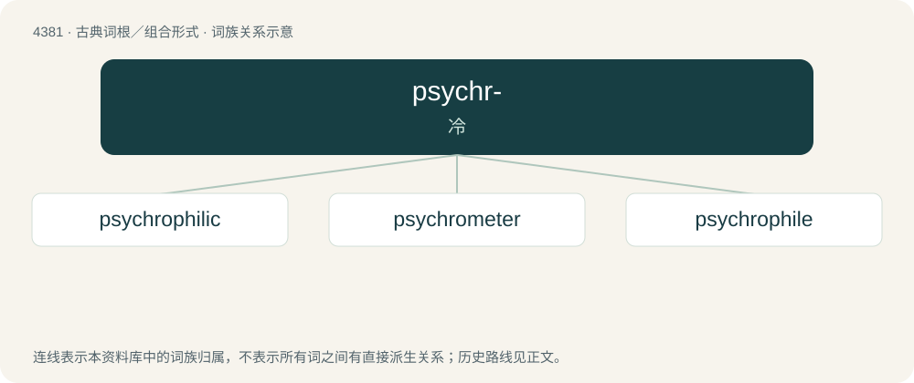

# 4381 · psychr- — 冷

[总目录](../00_总目录_按常用程度.md)

**类型**：古典词根／组合形式　｜　**来源语言**：古希腊语

## 核心含义与来源

- 核心含义：冷
- 英文含义：cold
- 词形：psychr-

**来源词形**：ψύχω, ψυχρός (psukhrós), ψυχρότης

## 词族图

## 单词速览（常用到不常用）

| 单词 | 音标 | 释义 |
|---|---|---|
| [psychrophilic](#w-1) | /.saikrəuˈfilik/ | a. 好寒性的；\[医\] 嗜冷的 |
| [psychrometer](#w-2) | /saiˈkrɒmitə/ | n. 干湿计；\[化\] 湿度计 |
| [psychrophile](#w-3) |  | 低温微生物 |

## 逐词详解

### 1. psychrophilic

**词性**：形容词　｜　**音标**：/.saikrəuˈfilik/

**中文释义**：a. 好寒性的；\[医\] 嗜冷的

**英文义项**：Especially of certain bacteria: capable of living at relatively low temperature.

**构词拆分**：psychro- + -philic

**词源与演化**：

From psychro- + -philic.

**例句**：

> Psychrophilic organisms thrive in cold temperatures.

### 2. psychrometer

**词性**：名词　｜　**音标**：/saiˈkrɒmitə/

**中文释义**：n. 干湿计；\[化\] 湿度计

**英文义项**：Any of several instruments used to measure the relative humidity of the atmosphere; especially a wet-and-dry-bulb hygrometer.

**构词拆分**：psychro- + -meter

**词源与演化**：

From psychro- + -meter.

**例句**：

> You can use a psychrometer to measure relative humidity.

### 3. psychrophile

**词性**：名词

**中文释义**：低温微生物

**英文义项**：An organism that can live and thrive at temperatures much lower than normal; a form of extremophile.

**构词拆分**：psychro- + -phile

**词源与演化**：

From psychro- + -phile.

## 其他候选词

- psychroalgia
- psychrophily
