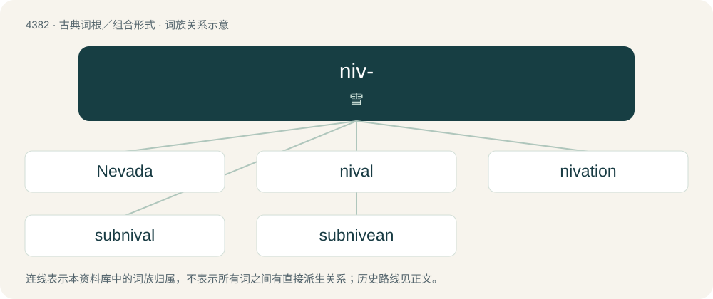

# 4382 · niv- — 雪

[总目录](../00_总目录_按常用程度.md)

**类型**：古典词根／组合形式　｜　**来源语言**：拉丁语

## 核心含义与来源

- 核心含义：雪
- 英文含义：snow
- 词形：niv-

**来源词形**：nix, nivis

## 词族图

## 单词速览（常用到不常用）

| 单词 | 音标 | 释义 |
|---|---|---|
| [Nevada](#w-1) | 英 /nəˈvɑːdə/；美 /nɪˈvædə/ | n. 内华达 |
| [nival](#w-2) | /ˈnaivəl/ | a. 雪的, 多雪的 |
| [nivation](#w-3) | /naiˈveiʃən/ | n. \[地\]雪蚀 |
| [subnival](#w-4) | 英 /sʌbˈnaɪvl̩/；美 /ˌsʌbˈnaɪv(ə)l/ | \[网络\] 雪下的 |
| [subnivean](#w-5) | /,sʌbˈniviən/ | 雪下的 |

## 逐词详解

### 1. Nevada

**词性**：专有名词　｜　**音标**：英 /nəˈvɑːdə/；美 /nɪˈvædə/

**中文释义**：n. 内华达

**英文义项**：A state in the western United States. Capital: Carson City. Largest city: Las Vegas. / A city, the county seat of Story County, Iowa, named for the Sierra Nevada mountains.

**词源与演化**：

Borrowed from Spanish Nevada, from nevada (“snow-covered”).

**例句**：

> Being from moist cool BC, I appreciate the dry heat in Nevada.

### 2. nival

**词性**：形容词　｜　**音标**：/ˈnaivəl/

**中文释义**：a. 雪的, 多雪的

**英文义项**：Abounding with snow; snowy; snow-covered (now especially in reference to plant habitats). / Found or thriving in snowy conditions.

**词源与演化**：

From Latin nivalis, from nix, nivis (“snow”).

### 3. nivation

**词性**：名词　｜　**音标**：/naiˈveiʃən/

**中文释义**：n. \[地\]雪蚀

**英文义项**：Erosion caused by freezing and thawing due to snow.

**词源与演化**：

Coined by Dutch-American topographer and geologist François E. Matthes.

### 4. subnival

**词性**：形容词　｜　**音标**：英 /sʌbˈnaɪvl̩/；美 /ˌsʌbˈnaɪv(ə)l/

**中文释义**：\[网络\] 雪下的

**英文义项**：Of a habitat: of an altitude, latitude, or type just below that which would be permanently covered by snow (the snow line). / Growing or capable of growing, or occurring, underneath snow; subnivean.

**构词拆分**：sub- (prefix meaning ‘beneath, under’) + nival (“abounding with snow; snow-covered, snowy; found or thriving in snowy conditions”)

**词源与演化**：

From sub- (prefix meaning ‘beneath, under’) + nival (“abounding with snow; snow-covered, snowy; found or thriving in snowy conditions”), borrowed from German subnival, from Late Latin subnivalis, from Latin sub- (prefix meaning ‘beneath, under’) + nivālis (“snow-covered; snowy”) (from nix (“snow”) (ultimately from Proto-Indo-European \*sneygʷʰ- (“to snow”)) + -ālis (suffix forming adjectives of relationship)).

### 5. subnivean

**词性**：形容词　｜　**音标**：/,sʌbˈniviən/

**中文释义**：雪下的

**英文义项**：Occurring beneath a layer of snow; subnival.

**构词拆分**：sub- + nivean

**词源与演化**：

From sub- + nivean.

## 其他候选词

- névé
- niveus
