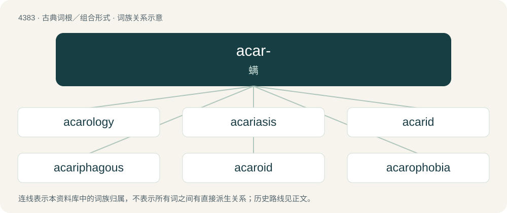

# 4383 · acar- — 螨

[总目录](../00_总目录_按常用程度.md)

**类型**：古典词根／组合形式　｜　**来源语言**：古希腊语

## 核心含义与来源

- 核心含义：螨
- 英文含义：mite
- 词形：acar-

**来源词形**：ἀκαρί (akarí)

## 词族图

## 单词速览（常用到不常用）

| 单词 | 音标 | 释义 |
|---|---|---|
| [acarology](#w-1) | 英 /æ.kəˈɹɒ.lə.d͡ʒi/；美 /æ.kəˈɹɑ.lə.d͡ʒi/ | n. \[动\]蜱螨学,螨学 |
| [acariasis](#w-2) | /ˌæk.əˈɹaɪ.ə.sɪs/ | n. 疥癣, 疥虫病 |
| [acarid](#w-3) | /ˈæk.ə.ɹɪd/ | n. 螨；\[医\] 螨 |
| [acariphagous](#w-4) |  | 【英文】That feeds on mites |
| [acaroid](#w-5) | /ˈæk.əˌɹɔɪd/ | a. 螨的, 螨状的 |
| [acarophobia](#w-6) | /ˌækəɹəˈfəʊbi.ə/ | n. \[医\]螨虫恐惧症 |
| [acarus](#w-7) | /ˈæk.ə.ɹəs/ | n. 螨；\[医\] 螨属 |

## 逐词详解

### 1. acarology

**词性**：名词　｜　**音标**：英 /æ.kəˈɹɒ.lə.d͡ʒi/；美 /æ.kəˈɹɑ.lə.d͡ʒi/

**中文释义**：n. \[动\]蜱螨学,螨学

**英文义项**：The study of ticks and mites.

**构词拆分**：acaro- + -logy

**词源与演化**：

From acaro- + -logy, based on Ancient Greek ἄκαρι (ákari, “cheese mite, tick”) + -λογία (-logía).

### 2. acariasis

**词性**：名词　｜　**音标**：/ˌæk.əˈɹaɪ.ə.sɪs/

**中文释义**：n. 疥癣, 疥虫病

**英文义项**：An infestation with, or disease caused by mites or ticks.

**构词拆分**：acar- + -iasis

**词源与演化**：

Circa 19th century, from acar- + -iasis.

### 3. acarid

**词性**：名词　｜　**音标**：/ˈæk.ə.ɹɪd/

**中文释义**：n. 螨；\[医\] 螨

**英文义项**：Any parasitic arachnid, such as mites and ticks, of the subclass Acarina.

**词源与演化**：

Circa 19th century; from New Latin Acaridae (“biological family”), from Acarus (“genus”), from acarus (“mite”), from Ancient Greek ἄκαρι (ákari, “mite”). By surface analysis, acar- + -id

### 4. acariphagous

**词性**：形容词

**英文义项**：That feeds on mites

**构词拆分**：acar- + -i- + -phagous

**词源与演化**：

From acar- + -i- + -phagous.

### 5. acaroid

**词性**：形容词　｜　**音标**：/ˈæk.əˌɹɔɪd/

**中文释义**：a. 螨的, 螨状的

**英文义项**：Shaped like or resembling a mite.

**构词拆分**：New Latin acarus (“member of the former inclusive genus of mites”) + -oid (“likeness”)

**词源与演化**：

From New Latin acarus (“member of the former inclusive genus of mites”) + -oid (“likeness”).

### 6. acarophobia

**词性**：名词　｜　**音标**：/ˌækəɹəˈfəʊbi.ə/

**中文释义**：n. \[医\]螨虫恐惧症

**英文义项**：The fear of itching or of small crawling insects that cause itching, such as mites or lice.

**词源与演化**：

From acaro- + -phobia.

**例句**：

> His acarophobia was obvious from his reaction when I told him he had lice.

该用例对应义项：The fear of itching or of small crawling insects that cause itching, such as mites or lice.

### 7. acarus

**词性**：名词　｜　**音标**：/ˈæk.ə.ɹəs/

**中文释义**：n. 螨；\[医\] 螨属

**英文义项**：Any member of the subclass Acari (aka Acarina): thus, a mite or a tick; specifically, any mite of the genus Acarus.

**词源与演化**：

Learned borrowing from taxonomic name Acarus, from Ancient Greek ἀκαρί (akarí, “cheese mite, tick”).

**例句**：

> If you're allergic to acarus, you need to clean your bedclothes, your carpet and your rugs.
