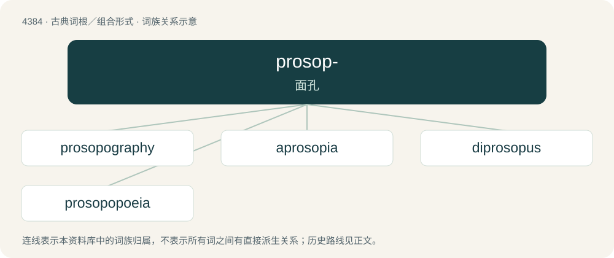

# 4384 · prosop- — 面孔

[总目录](../00_总目录_按常用程度.md)

**类型**：古典词根／组合形式　｜　**来源语言**：古希腊语

## 核心含义与来源

- 核心含义：面孔
- 英文含义：face
- 词形：prosop-

**来源词形**：πρόσωπον (prósōpon)

## 词族图

## 单词速览（常用到不常用）

| 单词 | 音标 | 释义 |
|---|---|---|
| [prosopography](#w-1) | /ˌprɔsəuˈpɔɡrəfi/ | n. （研究人的外貌、性格等的）人学, 人物传记 |
| [aprosopia](#w-2) | /æpɹəˈsəʊpɪə/ | \[医\] 无面\[畸形\] |
| [diprosopus](#w-3) | /daiˈprɔsəpəs/ | \[医\]双面畸胎 |
| [prosopopoeia](#w-4) | /pɹəˌsəʊpəˈpiːə/ | n. 拟人法, 活现法 |

## 逐词详解

### 1. prosopography

**词性**：名词　｜　**音标**：/ˌprɔsəuˈpɔɡrəfi/

**中文释义**：n. （研究人的外貌、性格等的）人学, 人物传记

**英文义项**：A study of the individuals in a group of people within a specific context and their relationships.

**构词拆分**：prosopo- + -graphy

**词源与演化**：

From international scientific vocabulary, reflecting New Latin combining forms: prosopo- + -graphy; from the Latin prosōpographia (“description of a person’s appearance; description of an individual’s life”), from the Ancient Greek πρόσωπον (prósōpon, “face, person”) + -γρᾰφῐ́ᾱ (-grăphĭ́ā, “writing, drawing”). See also prosopon.

### 2. aprosopia

**词性**：名词　｜　**音标**：/æpɹəˈsəʊpɪə/

**中文释义**：\[医\] 无面\[畸形\]

**英文义项**：having an underdeveloped face, or having no face

**词源与演化**：

From Ancient Greek ἀ- (a-) + πρόσωπον (prósōpon, “face”) + -ῐᾰ (-ĭă).

### 3. diprosopus

**词性**：名词　｜　**音标**：/daiˈprɔsəpəs/

**中文释义**：\[医\]双面畸胎

**英文义项**：A condition in which part of the face is duplicated on the head.

**词源与演化**：

From Ancient Greek πρόσωπον (prósōpon, “face”). By surface analysis, di- (“two”) + prosop- + Latin -us.

### 4. prosopopoeia

**词性**：名词　｜　**音标**：/pɹəˌsəʊpəˈpiːə/

**中文释义**：n. 拟人法, 活现法

**英文义项**：An act of personifying a person or object when communicating to an audience; a figure of speech involving this. / The personification of an abstraction.

**词源与演化**：

Learned borrowing from Ancient Greek προσωποποιία (prosōpopoiía, “dramatization, the putting of speeches into the mouths of characters”). By surface analysis, prosopo- + -poeia.

## 其他候选词

- prosoponym
- prosopospasm
