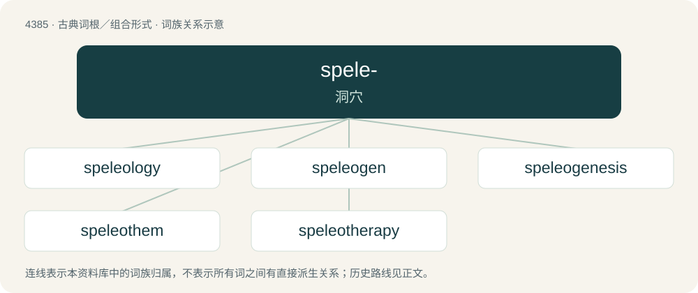

# 4385 · spele- — 洞穴

[总目录](../00_总目录_按常用程度.md)

**类型**：古典词根／组合形式　｜　**来源语言**：古希腊语

## 核心含义与来源

- 核心含义：洞穴
- 英文含义：cavern
- 词形：spele-

**来源词形**：σπέος (spéos), σπήλαιον (spḗlaion)

## 词族图

## 单词速览（常用到不常用）

| 单词 | 音标 | 释义 |
|---|---|---|
| [speleology](#w-1) | /,spiliˈɔlədʒi/ | n. 洞穴学 |
| [speleogen](#w-2) | /ˈspiːliə,dʒen/ | 次生洞穴结构 |
| [speleogenesis](#w-3) |  | 【英文】The formation and development of caves |
| [speleothem](#w-4) | 英 /ˈspiːlioʊˌθɛm/；美 /ˈspiːliəˌθɛm/ | n. \[地\]洞穴堆积物(如钟乳石) |
| [speleotherapy](#w-5) |  | 【英文】The use of the microclimate of salt caves and mines for the treatment of asthma. |

## 逐词详解

### 1. speleology

**词性**：名词　｜　**音标**：/,spiliˈɔlədʒi/

**中文释义**：n. 洞穴学

**英文义项**：The scientific study of caves. / The recreational activity of exploring caves.

**构词拆分**：speleo- + -logy

**词源与演化**：

From French spéléologie, coined by Émile Rivière in 1890. The word can be broken down as speleo- + -logy.

### 2. speleogen

**词性**：名词　｜　**音标**：/ˈspiːliə,dʒen/

**中文释义**：次生洞穴结构

**英文义项**：A geological feature within a karst system that is created by the dissolution of bedrock.

### 3. speleogenesis

**词性**：名词

**英文义项**：The formation and development of caves

**构词拆分**：speleo- + genesis

**词源与演化**：

From speleo- + genesis.

### 4. speleothem

**词性**：名词　｜　**音标**：英 /ˈspiːlioʊˌθɛm/；美 /ˈspiːliəˌθɛm/

**中文释义**：n. \[地\]洞穴堆积物(如钟乳石)

**英文义项**：Any secondary mineral, deposited in a natural cave by the action of water. Includes formations such as stalactites, stalagmites, flowstones, and helictites.

**词源与演化**：

From Ancient Greek σπήλαιον (spḗlaion, “cave”) + θέμα (théma, “what is laid down”).

### 5. speleotherapy

**词性**：名词

**英文义项**：The use of the microclimate of salt caves and mines for the treatment of asthma.

**构词拆分**：speleo- + therapy

**词源与演化**：

From speleo- + therapy.

## 其他候选词

- Speleomantes
- speleomorphology
- speleoseismite
