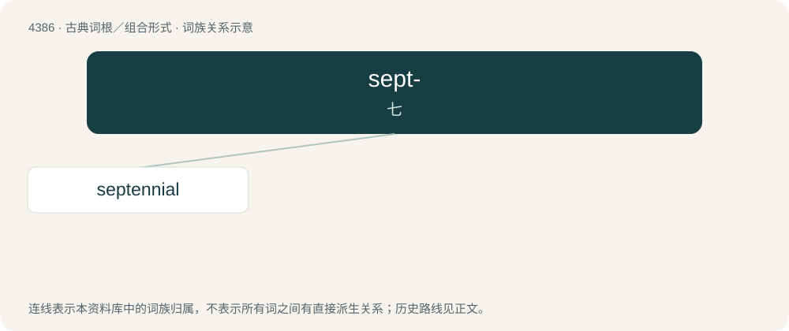

# 4386 · sept- — 七

[总目录](../00_总目录_按常用程度.md)

**类型**：古典词根／组合形式　｜　**来源语言**：拉丁语

## 核心含义与来源

- 核心含义：七
- 英文含义：seven
- 词形：sept-

**来源词形**：septem

## 词族图

## 单词速览（常用到不常用）

| 单词 | 音标 | 释义 |
|---|---|---|
| [septennial](#w-1) | 美 /sɛpˈtɛniəl/ | a. 延续七年的, 每七年一次的 |

## 逐词详解

### 1. septennial

**词性**：形容词　｜　**音标**：美 /sɛpˈtɛniəl/

**中文释义**：a. 延续七年的, 每七年一次的

**英文义项**：Of or relating to a 7 year period.

**词源与演化**：

From septennium + -al, from Latin septennis (“7-year”), q.v.

**例句**：

> septennial parliaments... septennial elections...

该用例对应义项：Of or relating to a 7 year period.
