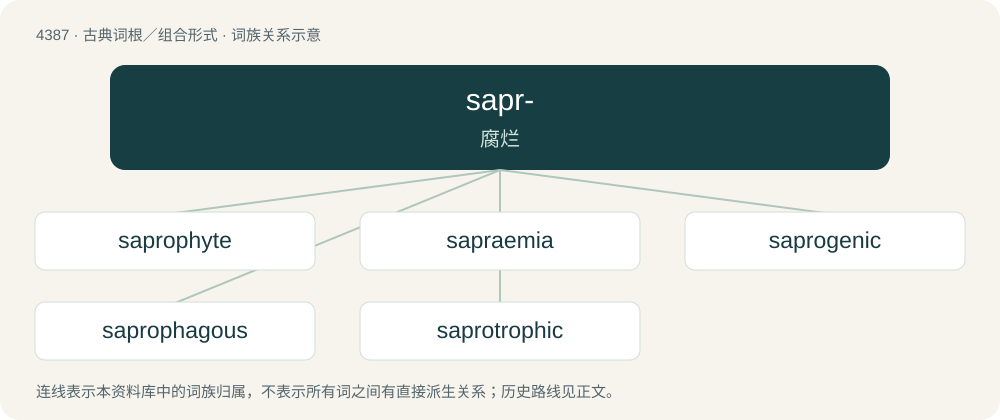

# 4387 · sapr- — 腐烂

[总目录](../00_总目录_按常用程度.md)

**类型**：古典词根／组合形式　｜　**来源语言**：古希腊语

## 核心含义与来源

- 核心含义：腐烂
- 英文含义：rotten
- 词形：sapr-

**来源词形**：σήπειν, σαπρός (saprós), σαπρότης

## 词族图

## 单词速览（常用到不常用）

| 单词 | 音标 | 释义 |
|---|---|---|
| [saprophyte](#w-1) | /ˈsæpɹəʊfaɪt/ | n. 腐生生物；\[医\] 腐\[物寄\]生物, 死物寄生菌 |
| [sapraemia](#w-2) | /sæˈpriːmiə/ | n. 腐血症, 脓毒中毒 |
| [saprogenic](#w-3) | /,sæprəuˈdʒenik/ | a. 引起腐烂的, 由腐烂产生的；\[医\] 生腐的, 腐化的 |
| [saprophagous](#w-4) | /sæpˈrɒfəgəs/ | a. 食腐的；\[医\] 腐物寄生的 |
| [saprotrophic](#w-5) | /,sæprəˈtrɔfik/ | 腐生营养的, 污水营养的 |

## 逐词详解

### 1. saprophyte

**词性**：名词　｜　**音标**：/ˈsæpɹəʊfaɪt/

**中文释义**：n. 腐生生物；\[医\] 腐\[物寄\]生物, 死物寄生菌

**英文义项**：Any organism that lives on dead organic matter, as certain fungi and bacteria.

**构词拆分**：sapro- (“putrid matter”) + -phyte (“plant, growth”)

**词源与演化**：

From sapro- (“putrid matter”) + -phyte (“plant, growth”).

### 2. sapraemia

**词性**：名词　｜　**音标**：/sæˈpriːmiə/

**中文释义**：n. 腐血症, 脓毒中毒

**英文义项**：blood poisoning caused by the ingestion/absorption of toxins of putrefactive bacteria.

**构词拆分**：sapro- + -aemia

**词源与演化**：

From sapro- + -aemia.

### 3. saprogenic

**词性**：形容词　｜　**音标**：/,sæprəuˈdʒenik/

**中文释义**：a. 引起腐烂的, 由腐烂产生的；\[医\] 生腐的, 腐化的

**英文义项**：Causing or resulting from putrefaction.

**构词拆分**：sapro- + -genic

**词源与演化**：

From sapro- + -genic.

### 4. saprophagous

**词性**：形容词　｜　**音标**：/sæpˈrɒfəgəs/

**中文释义**：a. 食腐的；\[医\] 腐物寄生的

**英文义项**：Feeding on dead or decaying organic matter.

**构词拆分**：sapro- (“putrid, rotten matter”) + -phagous (“eating, feeding on”)

**词源与演化**：

From sapro- (“putrid, rotten matter”) + -phagous (“eating, feeding on”).

### 5. saprotrophic

**词性**：形容词　｜　**音标**：/,sæprəˈtrɔfik/

**中文释义**：腐生营养的, 污水营养的

**英文义项**：of or pertaining to saprotrophs (or saprobes)

**构词拆分**：saprotroph + -ic

**词源与演化**：

From saprotroph + -ic.
