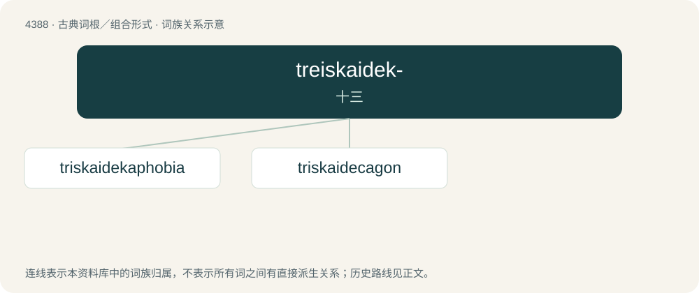

# 4388 · treiskaidek- — 十三

[总目录](../00_总目录_按常用程度.md)

**类型**：古典词根／组合形式　｜　**来源语言**：古希腊语

## 核心含义与来源

- 核心含义：十三
- 英文含义：thirteen
- 词形：treiskaidek-

**来源词形**：τρεισκαίδεκα (treiskaídeka)

## 词族图

## 单词速览（常用到不常用）

| 单词 | 音标 | 释义 |
|---|---|---|
| [triskaidekaphobia](#w-1) | /ˌtɹɪskaɪdɛkəˈfəʊbi.ə/ | n. 恐数字13症 |
| [triskaidecagon](#w-2) |  | 【英文】A polygon having thirteen sides and thirteen angles. |

## 逐词详解

### 1. triskaidekaphobia

**词性**：名词　｜　**音标**：/ˌtɹɪskaɪdɛkəˈfəʊbi.ə/

**中文释义**：n. 恐数字13症

**英文义项**：Fear or dislike of the number thirteen (13).

**构词拆分**：triskaideka- + -phobia

**词源与演化**：

From triskaideka- (“thirteen”) + -phobia.

### 2. triskaidecagon

**词性**：名词

**英文义项**：A polygon having thirteen sides and thirteen angles.

**构词拆分**：triskaideca- + -gon

**词源与演化**：

From triskaideca- + -gon.
