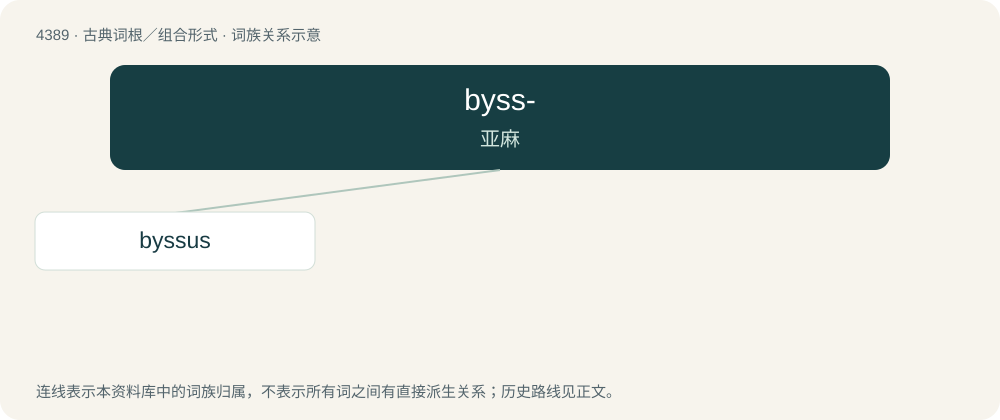

# 4389 · byss- — 亚麻

[总目录](../00_总目录_按常用程度.md)

**类型**：古典词根／组合形式　｜　**来源语言**：古希腊语

## 核心含义与来源

- 核心含义：亚麻
- 英文含义：flax
- 词形：byss-

**来源词形**：βύσσος (bússos)

## 词族图

## 单词速览（常用到不常用）

| 单词 | 音标 | 释义 |
|---|---|---|
| [byssus](#w-1) | /ˈbɪsəs/ | n. 古代的亚麻布, (贝类的)足丝 |

## 逐词详解

### 1. byssus

**词性**：名词　｜　**音标**：/ˈbɪsəs/

**中文释义**：n. 古代的亚麻布, (贝类的)足丝

**英文义项**：The long fine silky filaments excreted by several mollusks (particularly Pinna nobilis) by which they attach themselves to the sea bed, and from which sea silk is manufactured. / Sea silk manufactured from these filaments.

**词源与演化**：

From Latin byssus, from Ancient Greek βύσσος (bússos, “flax; flax cotton”), from a Semitic source cognate to Hebrew בּוּץ (būṣ, “byssus”) and Aramaic בּוּצָא (būṣā, “byssus”)
