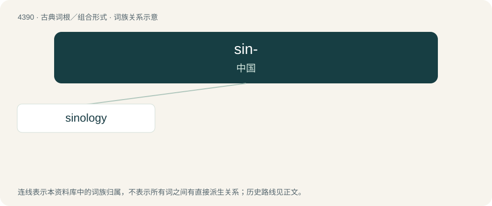

# 4390 · sin- — 中国

[总目录](../00_总目录_按常用程度.md)

**类型**：古典词根／组合形式　｜　**来源语言**：拉丁语

## 核心含义与来源

- 核心含义：中国
- 英文含义：China, chinese
- 词形：sin-

**来源词形**：Sina

## 词族图

## 单词速览（常用到不常用）

| 单词 | 音标 | 释义 |
|---|---|---|
| [sinology](#w-1) | /saɪˈnɒləd͡ʒi/ | 【英文】The study of the history, language and culture of China; Chinese studies. |

## 逐词详解

### 1. sinology

**词性**：名词　｜　**音标**：/saɪˈnɒləd͡ʒi/

**英文义项**：The study of the history, language and culture of China; Chinese studies. / The study of the internal politics of the high members of the government of the People's Republic of China.

**构词拆分**：sino- (“China”) + -logy (“study of”)

**词源与演化**：

From sino- (“China”) + -logy (“study of”).

## 其他候选词

- Sinanthropus
